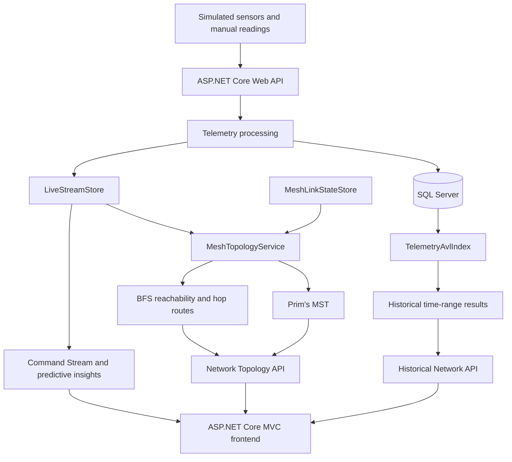

# 📡 Smart-X IoT Gateway

Smart-X is a hybrid IoT platform for monitoring and managing distributed sensors and actuators. It uses **ASP.NET Core Web API** for the backend, **ASP.NET Core MVC** for the frontend, and **SQL Server** for stored data. The assignment demonstrates C# data structures and algorithms through live telemetry, device commands, predictive insights, graph routing, and historical searches.

The application is organised into **three pillars**:

1. **📡 Live Telemetry Monitoring:** Register sensors, view changing readings, identify anomalies, inspect charts, and manage sensor files. A background service generates simulated telemetry approximately every **5 seconds**.
2. **🎮 Command Stream:** View live device status, process normal and critical readings, issue simulated actuator commands, undo commands, and receive suggested actions.
3. **🕸️ Network Topology:** View a simulated wireless mesh, explore reachable sensors with **Breadth-First Search (BFS)**, select low-cost network connections with **Prim's Minimum Spanning Tree (MST)**, simulate link failures, and search historical readings using an **AVL Tree**.

> **Part 3 focus:** Weighted graphs, adjacency lists, BFS, Prim's MST, simulated link failure and recovery, and an AVL index for timestamp-range searches. The wireless connections and energy costs are simulated, not measured from physical hardware.

## 📑 Contents

- [1. Project overview](#1-project-overview)
- [2. How to run the complete application](#2-how-to-run-the-complete-application)
- [3. Using all three pillars](#3-using-all-three-pillars)
- [4. Architecture and data flow](#4-architecture-and-data-flow)
- [5. Project structure](#5-project-structure)
- [6. Data structures and design choices](#6-data-structures-and-design-choices)
- [7. Part 3: Mesh theory and graph routing](#7-part-3-mesh-theory-and-graph-routing)
- [8. Part 3: AVL historical telemetry](#8-part-3-avl-historical-telemetry)
- [9. How to test Part 3](#9-how-to-test-part-3)
- [10. Tests for existing Part 1 and Part 2 functionality](#10-tests-for-existing-part-1-and-part-2-functionality)
- [11. API reference](#11-api-reference)
- [12. Performance, limitations, and troubleshooting](#12-performance-limitations-and-troubleshooting)
- [13. Demonstration and author](#13-demonstration-and-author)

---

## 1. 🎯 Project overview

Smart-X monitors numeric and Boolean telemetry, stores historical readings, detects abnormal values, and supports simulated actuator commands. It is not a single dashboard. Each of the three pillars provides a different view of the IoT system.

| Assignment part | Main features | Contribution |
|---|---|---|
| **Part 1: Telemetry foundation** | Sensor management, typed telemetry, SQL Server storage, charts, encrypted file uploads, jagged arrays and recursive deployment validation | Establishes the devices and readings used throughout the application |
| **Part 2: Commands and predictive insights** | FIFO and priority queues, dictionaries, hash sets, Undo stack, command history and suggested actions | Processes live data and makes device monitoring interactive |
| **Part 3: Trees and graphs** | Weighted mesh, adjacency list, BFS, Prim's MST, link-failure simulation and AVL timestamp index | Demonstrates network connectivity and efficient searching of historical readings |

In the Part 3 simulation, a device does not have to be directly connected to the gateway. Data can travel through neighbouring sensors. If a simulated link fails, Smart-X recalculates which sensors can still reach the gateway and which connections belong to the new MST.

---

## 2. 🚀 How to run the complete application

Follow **Option A** if you want to run the API and MVC frontend separately with .NET. Follow **Option B** if you want Docker Compose to start the API, MVC application and SQL Server together. **You only need one option.**

### 2.1 ✅ Prerequisites

For **🛠️ Option A (local development)**:

- **.NET 10 SDK**, including the `dotnet` command.
- **SQL Server Express LocalDB** on Windows, or another accessible SQL Server instance.
- **Git** to clone the repository.
- **Visual Studio with .NET 10 support** is optional. All steps below work from PowerShell.

For **🐳 Option B (Docker)**:

- **Git**.
- **Docker Desktop** with Docker Compose and Linux containers enabled.
- Enough free disk space for the SQL Server image and the two .NET images.

### 2.2 Download the project (both options)

Open **PowerShell** and run:

```powershell
git clone https://github.com/EMECPE/prog7312-2026-poe-ghanief.git
cd prog7312-2026-poe-ghanief
```

All commands below are run from this **repository root**, which contains `SmartXMvc.slnx` and `docker-compose.yml`.

### Option A: Run the backend and frontend separately

#### Step 1: Check that .NET is installed

```powershell
dotnet --version
```

The command should report a **10.x** SDK. If it does not, install the .NET 10 SDK before continuing.

#### Step 2: Restore NuGet dependencies

```powershell
dotnet restore SmartXMvc.slnx
```

This downloads the dependencies for both `SmartX_Api` and `SmartXMvc`.

#### Step 3: Compile the complete solution

```powershell
dotnet build SmartXMvc.slnx
```

Confirm that the output ends with `Build succeeded.` Fix build errors before starting the applications.

#### Step 4: Start or configure SQL Server

For a Windows LocalDB installation, check and start the default instance:

```powershell
sqllocaldb info
sqllocaldb start MSSQLLocalDB
```

The API's default local connection string in `SmartX_Api/appsettings.json` is:

```json
{
  "ConnectionStrings": {
    "DefaultConnection": "Server=(localdb)\\MSSQLLocalDB;Database=SmartXDb;Trusted_Connection=True;TrustServerCertificate=True;"
  }
}
```

#### Step 5: 🔑 Configure the file encryption key

Encrypted uploads require `FileEncryption:Key`, containing **32 random bytes encoded in Base64**. The API project already has a .NET user-secrets identifier. Generate a development key and save it outside the source code:

```powershell
$keyBytes = New-Object byte[] 32
$rng = [System.Security.Cryptography.RandomNumberGenerator]::Create()
$rng.GetBytes($keyBytes)
$rng.Dispose()
$key = [Convert]::ToBase64String($keyBytes)
dotnet user-secrets set "FileEncryption:Key" "$key" --project SmartX_Api
```

Keep the generated key if you want to decrypt files you previously uploaded with it. Do not commit encryption keys to GitHub.

#### Step 6: Check the MVC API address

`SmartXMvc/appsettings.json` should contain the following setting:

```json
{
  "SmartXApi": {
    "BaseUrl": "http://localhost:5095"
  }
}
```

This tells the MVC application where to contact the backend API.

#### Step 7: Start the backend API (PowerShell terminal 1)

```powershell
dotnet run --project SmartX_Api --launch-profile http
```

The backend should start at **http://localhost:5095**. In Development, API documentation is available at **http://localhost:5095/swagger**.

At startup, the API attempts to apply its existing EF Core migrations, seed demonstration data and load recent readings. Wait for the startup messages and check the terminal for SQL Server errors.

If you need to apply the existing migrations manually, you can install the EF Core CLI and run:

```powershell
dotnet tool install --global dotnet-ef --version 10.*
dotnet ef database update --project SmartX_Api --startup-project SmartX_Api
```

Do not create a new migration just to run the application.

#### Step 8: Start the MVC frontend (PowerShell terminal 2)

Keep terminal 1 running. Open **a second PowerShell terminal** in the repository root and run:

```powershell
dotnet run --project SmartXMvc --launch-profile http
```

The frontend should start at **http://localhost:5109**.

#### Step 9: Open and check the whole application

Open **http://localhost:5109** in your browser. Use the application navigation to open **Live Telemetry**, **Command Stream** and **Network Topology**. Check that the sensors load and readings begin updating. The three pillars use the same running backend API.

To stop locally running processes, press **Ctrl + C** in each terminal.

### Option B: Run everything with Docker Compose

This option starts all three services: `sqlserver`, `api` and `mvc`. You do not need to run `dotnet run` in separate terminals.

#### Step 1: Start Docker Desktop

Check that Docker and Compose are available:

```powershell
docker --version
docker compose version
```

#### Step 2: Create the local `.env` file

From the repository root, generate a Base64 encryption key:

```powershell
$keyBytes = New-Object byte[] 32
$rng = [System.Security.Cryptography.RandomNumberGenerator]::Create()
$rng.GetBytes($keyBytes)
$rng.Dispose()
$key = [Convert]::ToBase64String($keyBytes)
```

Create `.env` using PowerShell. Replace the placeholder with **your own strong SQL Server password**:

```powershell
MSSQL_SA_PASSWORD=REPLACE_WITH_YOUR_OWN_STRONG_PASSWORD
FILE_ENCRYPTION_KEY=$key
```

Check that the password satisfies SQL Server's complexity requirements. **Do not commit `.env` to Git.** The project `.gitignore` excludes `.env` files.

#### Step 3: Build and start the entire application

```powershell
docker compose up --build -d
```

Docker builds the API and MVC applications, including their dependency restore and compilation, starts SQL Server, and waits for its health check before starting the API.

#### Step 4: Confirm the containers are running

```powershell
docker compose ps
```

You should see the `sqlserver`, `api` and `mvc` services. To inspect application startup messages, use:

```powershell
docker compose logs --tail=100 api
docker compose logs --tail=100 mvc
```

#### Step 5: Open the frontend

- **MVC application:** http://localhost:5109
- **Backend API:** http://localhost:5095
- **API Swagger UI:** http://localhost:5095/swagger (the API container runs in Development mode)

The MVC container uses `http://api:8080` internally, while the API connects to the database using the Docker service name `sqlserver`. Do not change the MVC container URL to `localhost:5095`.

#### Step 6: Stop and restart the Docker application

```powershell
# Stop the running services without deleting their data volumes.
docker compose stop

# Start the existing services again.
docker compose start

# Rebuild after changing source code.
docker compose up --build -d
```

---

## 3. 🏛️ Using all three pillars

### 📡 Pillar 1: Live Telemetry Monitoring

Open **Dashboard**, **Sensors** and **Telemetry** from the MVC navigation.

- The **Dashboard** shows current device information, telemetry values and charts.
- **Sensors** allows you to register and manage devices and change their connection status.
- **Telemetry** allows you to submit numeric or Boolean readings and view stored data.
- The API's `TelemetrySimulationService` generates changing readings approximately every **5 seconds**, helping demonstrate real-time trends and anomalies.
- The **Files** area supports sensor-related documents; uploaded files are encrypted before storage.
- Part 1 also demonstrates jagged-array batching and recursive validation of nested deployment nodes.

---

### 🎮 Pillar 2: Command Stream

Open **Command Stream** to inspect current sensor status, alerts, manual controls and suggested actions.

- The **FIFO queue** processes normal telemetry in arrival order.
- The **priority queue** gives critical readings priority over ordinary readings.
- A **dictionary** supports fast lookup of devices by identifier, while a **sorted dictionary** keeps live trends ordered by time.
- A **hash set** avoids duplicate disconnected-device identifiers.
- **Manual Override** issues simulated actuator commands. **Undo last** uses a stack to reverse the most recent eligible command first.
- **Suggested Actions** considers recent anomalies, disconnected devices, repeated searches and previous command patterns. Suggestions do not automatically execute commands.

---

### 🕸️ Pillar 3: Network Topology

Open **Network Topology** to inspect and interact with the simulated mesh.

- View sensors, the central gateway, candidate wireless links and their estimated **mJ** costs.
- Choose a sensor to display its **BFS fewest-hop route** and **Prim's MST route**.
- Use **Show MST links only** to focus on the connections selected by Prim's algorithm.
- Disable or restore an existing wireless link to see how connectivity and the MST change.
- Use **Historical Telemetry (AVL Tree)** to select a sensor, enter a date and time range, and inspect matching readings and search diagnostics.

These actions are simulations. Disabling a wireless connection in Network Topology does not disconnect the actual device or delete telemetry from SQL Server.

---

## 4. Architecture and data flow



**Live routing:** `LiveStreamStore` supplies sensor identifiers and online status. `MeshTopologyService` builds candidate links and an adjacency list, removes unavailable links, runs BFS and Prim's algorithm, and returns a network snapshot for the MVC graph.

**Historical searching:** SQL Server stores telemetry records. `TelemetryAvlIndex` loads readings for the selected sensor, organises them in a balanced tree by timestamp and ID, searches the requested time interval and returns matching readings with diagnostics.

**Command handling:** Telemetry processing updates the live state. The Command Stream reads the latest data and recorded commands to display alerts, support manual actions and generate suggestions.

---

## 5. 🏗️ Project structure

The following tree lists the **main source files** used by the three pillars. 

```text
prog7312-2026-poe-ghanief/
├── SmartX_Api/
│   ├── Controllers/
│   │   ├── SensorsController.cs             # Part 1: Sensor API
│   │   ├── TelemetryController.cs           # Part 1: Telemetry API
│   │   ├── FilesController.cs               # Part 1: Sensor files
│   │   ├── CommandStreamController.cs       # Part 2: Commands and insights
│   │   ├── NetworkTopologyController.cs     # Part 3: Graph and link state
│   │   └── HistoricalNetworkController.cs   # Part 3: AVL range searches
│   ├── Data/
│   │   └── SmartXDbContext.cs               # EF Core database context
│   ├── Models/
│   │   ├── Sensor.cs
│   │   ├── TelemetryReading.cs
│   │   ├── CommandHistoryEntry.cs
│   │   ├── PredictiveInsights.cs
│   │   └── MeshModels.cs                    # Part 3: Nodes, edges, routes
│   ├── Services/
│   │   ├── SensorService.cs
│   │   ├── TelemetryService.cs
│   │   ├── TelemetrySimulationService.cs    # Part 1: Live readings
│   │   ├── TelemetryAnomalyRules.cs         # Part 1: Threshold rules
│   │   ├── FileService.cs                   # Part 1: Encrypted uploads
│   │   ├── BatchTelemetryService.cs         # Part 1: Reading batches
│   │   ├── DeploymentValidationService.cs   # Part 1: Recursion
│   │   ├── DataSeeder.cs                    # Demonstration data
│   │   ├── LiveStreamStore.cs               # Part 2: Live lookup and trends
│   │   ├── TelemetryDispatchService.cs      # Part 2: FIFO and priority queues
│   │   ├── CommandOperationsService.cs      # Part 2: Commands and Undo
│   │   ├── PatternActivityStore.cs          # Part 2: Search patterns
│   │   ├── PredictiveInsightsService.cs     # Part 2: Suggestions
│   │   ├── MeshTopologyService.cs           # Part 3: Graph, BFS and Prim's MST
│   │   ├── MeshLinkStateStore.cs            # Part 3: Link failures
│   │   └── TelemetryAvlIndex.cs             # Part 3: AVL history searches
│   ├── Properties/launchSettings.json
│   ├── SmartX_Api.csproj
│   ├── Program.cs
│   └── appsettings.json
├── SmartXMvc/
│   ├── Controllers/
│   │   └── HomeController.cs                # MVC actions and API endpoints
│   ├── Models/
│   │   └── Dtos.cs
│   ├── Services/
│   │   └── SmartXApiClient.cs               # Calls the backend API
│   ├── Views/
│   │   ├── Home/
│   │   │   ├── Dashboard.cshtml
│   │   │   ├── Sensors.cshtml
│   │   │   ├── Telemetry.cshtml
│   │   │   ├── Files.cshtml
│   │   │   ├── CommandStream.cshtml          # Part 2
│   │   │   └── NetworkTopology.cshtml        # Part 3
│   │   └── Shared/
│   │       └── _Layout.cshtml
│   ├── wwwroot/
│   │   ├── js/
│   │   │   ├── dashboard.js
│   │   │   ├── sensors.js
│   │   │   ├── telemetry.js
│   │   │   ├── files.js
│   │   │   ├── command-stream.js
│   │   │   ├── predictive-insights.js
│   │   │   └── network-topology.js           
│   │   └── css/
│   │       ├── dashboard.css
│   │       ├── sensors.css
│   │       ├── telemetry.css
│   │       ├── command-stream.css
│   │       └── network-topology.css
│   ├── Properties/launchSettings.json
│   ├── SmartXMvc.csproj
│   ├── Program.cs
│   └── appsettings.json
├── SmartXMvc.slnx
└── docker-compose.yml
```

---

## 6. Data structures and design choices

Different features need different ways of organising data. A queue is suited to incoming work, a dictionary is suited to finding a known device, a graph is suited to examining connections, and an AVL tree is suited to searching timestamps.

| Data structure | Main file | What it solves |
|---|---|---|
| `Queue<T>` | `TelemetryDispatchService.cs` | Processes normal readings in first-in, first-out order |
| `PriorityQueue<T, int>` | `TelemetryDispatchService.cs` | Handles critical telemetry before normal queued work |
| `Stack<T>` | `CommandOperationsService.cs` | Undoes the most recent eligible command first |
| `Dictionary<TKey, TValue>` | `LiveStreamStore.cs` | Looks up live devices quickly by ID |
| `SortedDictionary<TKey, TValue>` | `LiveStreamStore.cs` | Keeps a live trend ordered by time |
| `HashSet<T>` | `LiveStreamStore.cs` | Avoids duplicate alert or disconnected IDs |
| `Queue<DateTime>` | `PatternActivityStore.cs` | Tracks searches within a five-minute window |
| **Adjacency list: `Dictionary<string, List<Link>>`** | `MeshTopologyService.cs` | Finds a sensor's neighbouring links without checking every possible pair |
| `List<Link>` | `MeshTopologyService.cs` | Holds candidate and selected graph connections |
| **BFS queue: `Queue<string>`** | `MeshTopologyService.cs` | Visits sensors one hop level at a time |
| **MST min-heap: `PriorityQueue<Link, (int Cost, string From, string To)>`** | `MeshTopologyService.cs` | Retrieves the cheapest eligible connection efficiently |
| `HashSet<string>` | `MeshTopologyService.cs` | Tracks vertices already in the MST and avoids cycles |
| `Dictionary<string, string?>` | `MeshTopologyService.cs` | Records parent links so BFS and MST routes can be reconstructed |
| `HashSet<string>` | `MeshLinkStateStore.cs` | Stores disabled connections without duplicates |
| **Per-device index: `Dictionary<string, DeviceIndex>`** | `TelemetryAvlIndex.cs` | Locates the correct sensor's historical tree without searching other sensors' readings |
| `TelemetryAvlIndex.cs` | `TelemetryAvlIndex.cs` | Keeps timestamped readings balanced for efficient range queries |
| `TelemetryAvlIndex.cs` | `TelemetryAvlIndex.cs` | Supports ordered traversal and automatic balancing |
| `TelemetryAvlIndex.cs` | `TelemetryAvlIndex.cs` | Orders readings and retains records with matching timestamps |

The next two sections show how the Part 3 structures work together, why they were chosen and code snippets from the project.

---

## 7. Part 3: Mesh theory and graph routing

### 7.1 🌳 Why use a graph and an MST?

A sensor mesh is a network in which some sensors can communicate through other sensors instead of relying on a direct gateway connection. Smart-X needs to know **which devices can still communicate** when a link is unavailable, and **which collection of links has the lowest total simulated energy cost**.

A graph represents these relationships clearly:

- **Vertices (V):** The sensors and one `CENTRAL-GATEWAY`.
- **Edges (E):** Candidate two-way wireless links.
- **Weights:** Estimated energy cost for one packet on each link.
- **Active links:** Links with both endpoints online and not disabled by the simulator.

The graph is deliberately **sparse**. Sensors form a ring with alternate links; a smaller number connect directly to the gateway. For a demonstration with **15 sensors**, the topology normally has **16 vertices and 34 candidate links** (15 ring, 15 alternate and 4 gateway connections).

**BFS** answers: *Which sensors can reach the gateway, and which route uses the fewest links?*

**Prim's MST** answers: *Which links connect all gateway-reachable vertices with the smallest possible total selected weight, without creating loops?*

For a fully connected graph of 16 vertices, the MST contains exactly **15 edges**, although the original graph offers 34 candidates. An MST minimises the **sum of its selected edge weights**. It does **not** promise that every individual sensor gets its cheapest route to the gateway.

---

### 7.2 ⚡ Adjacency list: storing the graph efficiently

Rather than checking all sensors against every other sensor whenever a route is explored, `MeshTopologyService.cs` stores each online device's available neighbours in a dictionary. The following is the project's `MakeAdjacency` method:

```csharp
private static Dictionary<string, List<Link>> MakeAdjacency(
    IEnumerable<string> onlineIds, List<Link> activeLinks)
{
    var graph = new Dictionary<string, List<Link>>(Ids);
    foreach (var id in onlineIds) graph[id] = new List<Link>();
    foreach (var link in activeLinks)
    {
        graph[link.From].Add(link);
        graph[link.To].Add(link with { From = link.To, To = link.From });
    }

    foreach (var neighbors in graph.Values)
        neighbors.Sort((a, b) => Ids.Compare(a.To, b.To));

    return graph;
}
```

**Role:** Each dictionary key is a sensor or gateway ID. Its list contains only the active links leading to neighbouring devices. Each undirected link is stored in both directions. Neighbours are sorted to make traversal output repeatable.

**Why it helps:** BFS and Prim's algorithm can access the relevant connections directly. The adjacency list takes **O(V + E)** storage, instead of **O(V²)** storage for a full connection matrix. Building the list and sorting neighbours has a setup cost, but later traversals avoid repeatedly scanning every possible sensor pair.

---

### 7.3 🧭 BFS: checking reachability and fewest-hop routes

BFS starts at `CENTRAL-GATEWAY` and explores immediate neighbours before travelling further into the network. It uses a queue to visit devices in that order.

From `MeshTopologyService.cs`:

```csharp
private static (List<string> Order, Dictionary<string, string?> Parent) BreadthFirstSearch(
    Dictionary<string, List<Link>> graph, string start)
{
    var order = new List<string>();
    var parent = new Dictionary<string, string?>(Ids) { [start] = null };
    var queue = new Queue<string>();
    queue.Enqueue(start);

    while (queue.Count > 0)
    {
        string current = queue.Dequeue();
        order.Add(current);
        foreach (var edge in graph[current])
        {
            if (parent.ContainsKey(edge.To)) continue;
            parent[edge.To] = current;
            queue.Enqueue(edge.To);
        }
    }

    return (order, parent);
}
```

**Role:** The queue visits sensors one hop level at a time. The `parent` dictionary records how each discovered sensor was reached, allowing the MVC page to display a route. A device not discovered from the gateway is unreachable through the current active links.

**Why it helps:** BFS takes **O(V + E)** time with an adjacency list. Every reachable vertex is discovered once and every reachable link is examined from its endpoints. It avoids testing every possible path. BFS finds **fewest-hop routes**, not lowest routes, because it does not compare edge weights.

---

### 7.4 🪙 Prim's MST: choosing minimum-total-cost connections

Prim's algorithm begins at the gateway and repeatedly adds the lowest-cost available edge that leads to a vertex.

This selection logic comes from `MeshTopologyService.cs`:

```csharp
var visited = new HashSet<string>(Ids) { start };
var parent = new Dictionary<string, string?>(Ids) { [start] = null };
var selected = new List<Link>();
int total = 0;
var minHeap = new PriorityQueue<Link, (int Cost, string From, string To)>();

void EnqueueNeighbors(string id)
{
    foreach (var edge in graph[id])
        if (!visited.Contains(edge.To))
            minHeap.Enqueue(edge, (edge.Cost, edge.From, edge.To));
}

EnqueueNeighbors(start);
while (minHeap.TryDequeue(out var edge, out _))
{
    if (!visited.Add(edge.To)) continue;
    selected.Add(edge);
    total += edge.Cost;
    parent[edge.To] = edge.From;
    EnqueueNeighbors(edge.To);
}
```

**Role of each structure:**

- The **priority queue** is a min-heap. It returns the smallest candidate weight without sorting the entire edge list on every selection.
- The **hash set** records vertices already added to the tree. If an edge points to one of those vertices, it is skipped so the tree cannot contain a cycle.
- The **parent dictionary** records chosen connections for reconstructing the displayed MST route.
- The **list** records which edges were selected and enables the total simulated energy cost to be calculated.

**Why it helps:** A min-heap makes repeated minimum-edge selection efficient. With this adjacency-list implementation and lazy priority queue, Prim's algorithm runs in approximately **O(E log E)** time and avoids the much slower approach of rescanning all candidate links to find each minimum.

**Important:** The MST is a minimum-cost network *as a whole*. A green MST line is not necessarily the cheapest possible individual route for every sensor. The graph's mJ values explain which connections Prim's algorithm compares.

---

### 7.5 🧮 How connection energy costs are calculated

Each candidate link receives a repeatable **simulated energy cost** based on a simulated distance, not a measurement from real hardware.

```text
Base energy       = 2 mJ
Energy per metre  = 0.1 mJ per metre
Distance          = Simulated distance between linked devices (m)

Energy (mJ) = ceil(2 + Distance × 0.1)
```

Rounding up to the next whole number. The project's simplified method is:

```csharp
private static int EstimateEnergyMilliJoules(int distanceMetres)
{
    const double baseEnergy = 2.0;
    const double energyPerMetre = 0.1;

    return (int)Math.Ceiling(baseEnergy + distanceMetres * energyPerMetre);
}
```

| Simulated distance | Calculation | Energy cost |
|---|---|---|
| 10 m | `ceil(2 + 10 × 0.1)` | 3 mJ |
| 20 m | `ceil(2 + 20 × 0.1)` | 4 mJ |
| 35 m | `ceil(2 + 35 × 0.1)` | 6 mJ |
| 50 m | `ceil(2 + 50 × 0.1)` | 7 mJ |

The distance variations are generated consistently from a pair of device identifiers. The same pair receives the same simulated cost while the identifiers and calculation remain unchanged. These values are **estimates used to demonstrate Prim's algorithm**.

---

### 7.6 ⛔ Simulated link failure and recovery

`MeshLinkStateStore.cs` uses a `HashSet<string>` of canonical link keys so a connection can be disabled without being stored twice. The key treats `A-B` and `B-A` as the same undirected link.

Code from `MeshLinkStateStore.cs`:

```csharp
private readonly HashSet<string> _disabled = new(IdComparer);

public void SetDisabled(string from, string to, bool disabled)
{
    lock (_gate)
    {
        string key = EdgeKey(from, to);
        if (disabled) _disabled.Add(key);
        else _disabled.Remove(key);
    }
}

public void Reset()
{
    lock (_gate) _disabled.Clear();
}
```

**Role:** The disabled-link set records which simulated links are unavailable. `MeshTopologyService` rebuilds its active adjacency list without those links and recalculates BFS and Prim's MST.

**Why it helps:** Checking whether a link is disabled has **O(1) average-time lookup** in a hash set. The project updates the network without changing sensor registrations or deleting database readings. If no alternative route exists, an online sensor can still be reported as **unreachable**. Disabled-link state is temporary and resets when the API process restarts.

---

## 8. 🌲🕐 Part 3: AVL historical telemetry

### 8.1 🌲❓ The problem the AVL Tree solves

SQL Server stores historical readings, but the Part 3 feature also demonstrates a custom **in-memory AVL Tree** for searching those records by timestamp. Imagine a sensor has thousands of readings and the user asks:

> Show the temperature readings recorded between **14:00 and 16:00**.

Searching an ordinary unsorted list would mean checking each reading individually, even those recorded far outside the requested interval. An unbalanced Binary Search Tree could also become a long chain when readings arrive in timestamp order.

An **AVL Tree** keeps its height balanced as readings are added. It can skip branches that cannot contain timestamps within the requested interval. This makes repeat in-memory searches more efficient than scanning a large list.

---

### 8.2 🌲🔑 Per-sensor indexes and timestamp keys

The implementation in `TelemetryAvlIndex.cs` has a separate tree for each device, held in a dictionary:

```csharp
private sealed class Node
{
    public TelemetryReading Reading;
    public Node? Left;
    public Node? Right;
    public int Height = 1;
    public Node(TelemetryReading reading) => Reading = reading;
}

private sealed class DeviceIndex
{
    public Node? Root;
    public int HighestId;
    public int Count;
}

private readonly Dictionary<string, DeviceIndex> _byDevice =
    new(StringComparer.OrdinalIgnoreCase);
```

**Role:** The dictionary finds the selected sensor's tree quickly. Each node holds a telemetry record, references to its left and right children, and height information for balancing. `HighestId` helps load only newly inserted SQL records after the initial index build.

The comparison key uses both timestamp and database record ID:

```csharp
private static int Compare(TelemetryReading x, TelemetryReading y)
{
    int timestampComparison = x.Timestamp.CompareTo(y.Timestamp);
    return timestampComparison != 0 ? timestampComparison : x.Id.CompareTo(y.Id);
}
```

This keeps readings ordered chronologically without losing records that share the same timestamp.

---

### 8.3 ⚖️🔄 Keeping the tree balanced

The project's `Insert` method refreshes node heights and rotates subtrees when necessary:

```csharp
Refresh(node);
int balance = Height(node.Left) - Height(node.Right);
if (balance > 1)
{
    if (Compare(value, node.Left!.Reading) > 0)
        node.Left = RotateLeft(node.Left);
    return RotateRight(node);
}
if (balance < -1)
{
    if (Compare(value, node.Right!.Reading) < 0)
        node.Right = RotateRight(node.Right);
    return RotateLeft(node);
}
return node;
```

**Role:** Rotations prevent one side of the tree from growing much deeper than the other.

**Why it helps:** A balanced AVL Tree has **O(log n)** height, supporting **O(log n)** insertion and lookup by key. Even if telemetry arrives mostly in timestamp order, the tree does not become a long single branch.

---

### 8.4 🎯📅 Searching only the relevant timestamp range

The `SearchRange` method is from `TelemetryAvlIndex.cs`:

```csharp
private static void SearchRange(Node? n, DateTime from, DateTime to,
    int max, List<TelemetryReading> output, ref int nodesVisited)
{
    if (n is null || output.Count >= max) return;
    nodesVisited++;
    if (n.Reading.Timestamp >= from)
        SearchRange(n.Left, from, to, max, output, ref nodesVisited);
    if (n.Reading.Timestamp >= from && n.Reading.Timestamp <= to && output.Count < max)
        output.Add(n.Reading);
    if (n.Reading.Timestamp <= to)
        SearchRange(n.Right, from, to, max, output, ref nodesVisited);
}
```

**Role:** If the current timestamp is earlier than `from`, the left subtree can be skipped. If it is later than `to`, the right subtree can be skipped. Matching records are returned in chronological order, subject to the result limit.

**Why it helps:** A balanced-tree range search generally takes **O(log n + k)** for `k` matching records, instead of **O(n)** for a full list scan. This is especially useful when the requested interval is small compared with the indexed history.

---

### 8.5 🔎📊 AVL search diagnostics

The History panel and API return information to help explain the algorithm:

| Field | Meaning |
|---|---|
| **Indexed readings** | Number of readings loaded into that sensor's AVL index |
| **Tree height** | Height of the AVL Tree, indicating how balanced it remains |
| **Nodes visited** | Number of nodes actually checked during the range search |
| **Returned readings** | Number of matching readings returned, subject to the result limit |
| **Search milliseconds** | Time spent traversing the in-memory AVL Tree only |
| **Truncated** | Indicates that more matches exist beyond the requested result limit |

---

## 9. 🧪 How to test Part 3

Start the API and MVC application using Section 2. These tests use the **Network Topology** page unless another location is specified.

### 🔗 Test 1: Check the graph and its link counts

1. Open **Network Topology**.
2. Confirm the `CENTRAL-GATEWAY` and registered sensor nodes appear.
3. Check that links are shown between neighbouring sensors, alternate sensors and selected gateway-connected sensors.
4. Inspect the displayed cost of a link in **mJ** by reading its label or selecting the connection.
5. With **15 online sensors**, expect **16 vertices** and usually **34 candidate links**. Counts change if a different number of sensors exists.

**Expected result:** The graph is visible, shows simulated connection weights and distinguishes available, MST-selected and disabled links. Counts describe the current data, not a hard-coded number of physical devices.

---

### 🔍🧭 Test 2: Check BFS reachability and fewest-hop routes

1. Select an online sensor in the graph or from **Sensor Routing**.
2. Select the **BFS fewest hops** route view.
3. Inspect the highlighted route and the **BFS Traversal** panel.
4. Count the connections along the route and compare that count with the displayed number of hops.

**Expected result:** BFS starts from the gateway, visits reachable devices and highlights a route with the fewest number of links. The hop count matches the number of edges in that route. The mJ value does not control BFS selection.

---

### 🌳 Test 3: Check Prim's Minimum Spanning Tree

1. Ensure all intended sensors are online and click **Reset all** in the link simulator.
2. Check the **Total MST energy** card.
3. Enable **Show MST links only**.
4. Select a sensor and inspect its **Prim's MST** route.
5. If all **16 vertices** are connected, verify that the MST has **15 selected edges**.
6. Compare the visible mJ costs of selected and unselected candidate links.

**Expected result:** The selected links form a connected tree without cycles and minimise the **total** selected edge cost. Changing the selected sensor highlights a route but does not change the computed MST itself.

---

### ⛔🔄 Test 4: Simulate a failed wireless connection

1. With the full graph visible, choose a currently active link in **Simulate Link Failure**, or click a link if the graph allows direct link selection.
2. Record the selected link and the current total MST cost.
3. Click **Disable link**.
4. Refresh or recalculate the graph if needed.
5. Examine the failed link, BFS reachability, the highlighted route and MST cost.
6. Click **Restore link** to reactivate it.

**Expected result:** The selected link becomes unavailable and BFS and Prim's MST are recalculated. The MST or a route may change **if the removed link affected the earlier solution**. Another path may keep the sensor reachable; if none exists, the sensor is shown as unreachable even if still online.

---

### 🔄 Test 5: Reset all simulated links

1. Disable two valid connections.
2. Confirm they appear as disabled in the graph or link controls.
3. Click **Reset all**.
4. Recalculate or refresh the network.

**Expected result:** Disabled links are restored and network results are recalculated. No SQL telemetry or sensor registration is deleted.

---

### 🌲🔎 Test 6: Search historical telemetry with the AVL Tree

1. Wait until the telemetry simulator has produced readings, or submit readings from **Telemetry**.
2. Open **Network Topology** and find **Historical Telemetry (AVL Tree)**.
3. Choose a sensor that has saved readings.
4. Select a **From** and **To** time containing those readings. For example, use **14:00 to 16:00 on a date with recorded data**.
5. Click **Search History**.
6. Check the timestamps and inspect **Indexed readings**, **Tree height**, **Nodes visited** and **Search milliseconds**, where displayed.
7. Repeat with a narrower interval and compare the number of results and nodes visited.

**Expected result:** Returned readings belong to the selected sensor and fall within the requested interval, in chronological order. The diagnostic values describe the in-memory AVL search. A narrower query will often visit fewer nodes, although the exact count depends on the tree and matching records.

---

### ⚠️ Test 7: Check invalid ranges and result limits

1. Set **From** later than **To** and try a history search.
2. Confirm the application rejects the invalid range.
3. Run a valid wider query with many readings.
4. If the result limit is reached, check whether the response reports `truncated`.

**Expected result:** Invalid time ranges are rejected. The backend accepts a `limit` between **1 and 500**; the MVC history query currently requests **200** readings. A truncated result does not mean the sensor has only that many stored readings.

---

## 10. Tests for existing Part 1 and Part 2 functionality

| Test | Steps | Expected result |
|---|---|---|
| **📡 Live telemetry** | Open Dashboard and watch an online sensor for at least 10 to 15 seconds | Its simulated readings or recent history update as the background service runs |
| **💾 Sensor and telemetry storage** | Open Sensors, select a valid sensor, and submit a reading in Telemetry | The reading is accepted and can be found in saved history |
| **🔒 Encrypted files** | Upload a supported document through Files after configuring the encryption key, then download it | The upload succeeds and the document can be retrieved through the application |
| **➡️ FIFO queue** | Submit normal values such as 24°C, 25°C and 26°C for `SENSOR-TEMP-001` | Normal work enters the FIFO queue; recorded readings can be inspected in sequence. The trend alone does not prove queue scheduling under concurrent load |
| **⚡ Priority queue** | Submit a normal 1800 W reading and an abnormal 6000 W reading for `SENSOR-POWER-005` | The abnormal value is identified as critical and an alert or suggestion becomes available |
| **📚 Dictionary lookup** | Search for `SENSOR-TEMP-001` in the Command Stream's Live Device Monitor | The matching sensor appears without scanning the visible list manually |
| **🕐 Sorted dictionary** | Submit several different readings for the same sensor and choose **View Trend** | Trend data is presented in chronological order |
| **🧮 Hash set** | Disconnect a sensor in Sensors, then open the disconnected filter in Command Stream | The sensor is tracked once; reconnect it when finished |
| **↩️ Command stack and Undo** | Issue two valid actuator commands in Manual Override, then select **Undo last** | The newest eligible command is reversed first |
| **🔍 Search pattern** | Search for the same sensor ID three times within five minutes in the Live Device Monitor | A frequently viewed sensor insight may appear in Suggested Actions |
| **⚠️ Anomaly insight** | Submit a 40°C reading for `SENSOR-TEMP-001` | An abnormal temperature insight or investigation suggestion appears |
| **💡 Learned command suggestion** | Repeat a similar anomaly and eligible actuator response, then reproduce the anomaly again | Suggested Actions can recommend the recorded response; **Prepare** fills the action without executing it |

---

## 11.📡🛠️ API reference

The backend serves these endpoints. The MVC frontend calls the API through `SmartXApiClient` and the MVC controller.

### Part 3 network and history endpoints

| Method | Endpoint | Purpose |
|---|---|---|
| `GET` | `/api/networktopology` | Returns nodes, links, BFS traversal, MST selections, costs and routes |
| `GET` | `/api/networktopology/route/{deviceIdentifier}` | Returns a sensor's current reachability and available route details |
| `PUT` | `/api/networktopology/links/state` | Disables or restores one existing simulated link |
| `POST` | `/api/networktopology/links/reset` | Restores all simulated links |
| `GET` | `/api/networktopology/history` | Searches one sensor's telemetry index by timestamp range |

--- 

## 13.🎓 Demonstration video and author

**Project demonstration:**  [link]

- **Student:** Ghanief Batchelor
- **Student number:** ST10440143
- **Module:** PROG7312
