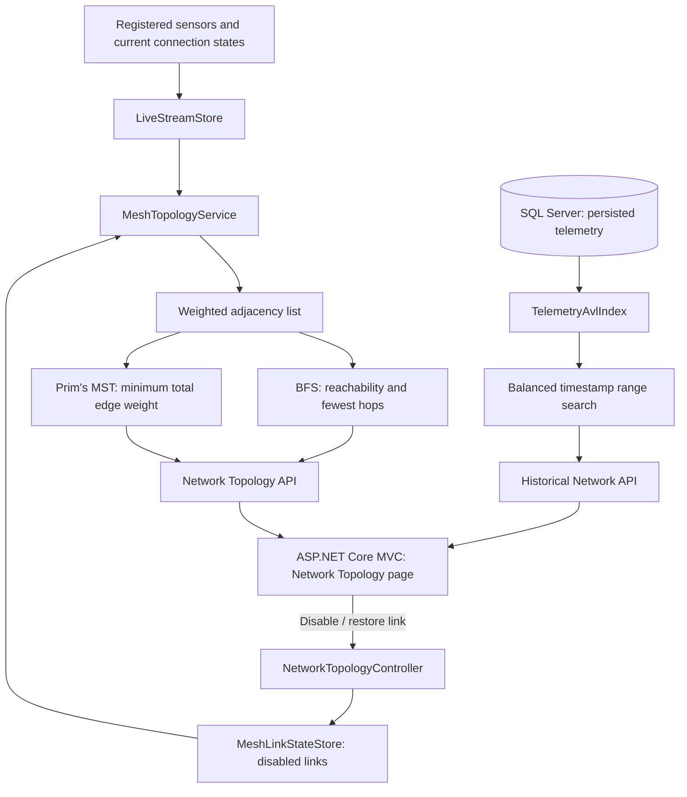

# 📡 Smart-X IoT Gateway — Part 3: Trees and Graphs

**Network Topology, Breadth-First Search (BFS), Prim's Minimum Spanning Tree (MST), and AVL-based historical telemetry queries.**

Smart-X is a .NET 10 IoT monitoring application built with **ASP.NET Core Web API**, **ASP.NET Core MVC**, and **SQL Server / Entity Framework Core**. This README is the **Part 3 implementation report**: it explains the new graph and tree structures in depth and provides the steps needed to **compile, run, and use the complete application suite**. Earlier project features are used as data sources but are not assessed or explained here.

> **Scope:** The radio network and transmission-energy costs are **simulated**. The project does not measure real wireless signal strength, radio power usage, or battery drain.

## 📑 Contents

- [Part 3 overview](#-part-3-overview)
- [Architecture and data flow](#️-architecture-and-data-flow)
- [Project structure](#-project-structure)
- [Compile and run the application](#-compile-and-run-the-application)
- [Using the Part 3 features](#️-using-the-part-3-features)
- [Part 3 data structures](#-part-3-data-structures)
- [Graphs, BFS, and Prim's MST](#-graphs-bfs-and-prims-mst)
- [AVL Tree and historical telemetry](#-avl-tree-and-historical-telemetry)
- [Performance and scalability](#-performance-and-scalability)
- [API reference](#-api-reference)
- [Part 3 demonstration guide](#-part-3-demonstration-guide)
- [Design decisions and limitations](#️-design-decisions-and-limitations)

---

## 🎯 Part 3 Overview

Part 3 adds two capabilities to Smart-X:

| Feature | Main classes | Contribution |
|---|---|---|
| **🌐 Weighted mesh network** | `MeshTopologyService`, `MeshLinkStateStore` | Models sensors and gateway links, finds reachable sensors with BFS, and selects a minimum-weight set of connections using Prim's algorithm |
| **🌲 Historical telemetry index** | `TelemetryAvlIndex`, `HistoricalNetworkController` | Balances timestamped readings in an AVL Tree, enabling efficient date-range searches and showing search diagnostics |

In the simulated network, **not every sensor connects directly to the central gateway**. Sensors may use neighbouring sensors as intermediate hops. When a connection fails, Smart-X rebuilds the active graph and recalculates the available BFS and MST routes.

An AVL Tree addresses a different problem: retrieving readings between two dates without scanning every entry in the in-memory history index.

---

## 🏗️ Architecture and Data Flow



**🔄 Two distinct data flows:**

1. **Network routing:** `LiveStreamStore` supplies device identifiers and online status → `MeshTopologyService` creates weighted wireless links and an adjacency list → BFS calculates reachability and fewest-hop paths → Prim's algorithm calculates the MST → MVC displays the graph and routes.
2. **Historical search:** Existing telemetry readings are persisted in SQL Server → `TelemetryAvlIndex` loads and indexes them by `(Timestamp, Id)` → balanced range traversal skips irrelevant branches → MVC displays the matching readings and tree diagnostics.

**Separation of responsibilities:** The **API** owns the algorithms and their calculations. The **MVC** application displays the results and forwards the user's requests. The graph is rendered with JavaScript, but BFS, Prim's and AVL searching are implemented in **C# services**, not recreated in the browser.

---

## 📁 Project Structure

The Part 3 files of interest are:

```text
prog7312-2026-poe-ghanief/
├── SmartX_Api/
│   ├── Controllers/
│   │   ├── NetworkTopologyController.cs      # Graph and link-state endpoints
│   │   └── HistoricalNetworkController.cs    # AVL history endpoint
│   ├── Models/
│   │   └── MeshModels.cs                     # Graph nodes, links, routes, snapshot
│   ├── Services/
│   │   ├── MeshTopologyService.cs            # Adjacency list, BFS, Prim's MST
│   │   ├── MeshLinkStateStore.cs             # In-memory disabled link set
│   │   └── TelemetryAvlIndex.cs              # Balanced timestamp index
│   └── Program.cs                            # Dependency injection
├── SmartXMvc/
│   ├── Controllers/HomeController.cs         # MVC proxy actions
│   ├── Services/SmartXApiClient.cs           # API client
│   ├── Views/Home/NetworkTopology.cshtml     # Part 3 interface
│   └── wwwroot/
│       ├── js/network-topology.js            # SVG graph, history, interactions
│       └── css/network-topology.css          # Dashboard styling
├── SmartXMvc.slnx
└── docker-compose.yml
```

| File | Specific contribution to Part 3 |
|---|---|
| [`MeshTopologyService.cs`](SmartX_Api/Services/MeshTopologyService.cs) | Generates candidate connections, filters active edges, builds adjacency lists, runs BFS and Prim's, and constructs routes |
| [`MeshLinkStateStore.cs`](SmartX_Api/Services/MeshLinkStateStore.cs) | Uses a `HashSet<string>` to remember manually disabled links |
| [`MeshModels.cs`](SmartX_Api/Models/MeshModels.cs) | Defines the network nodes, weighted edges and API responses |
| [`TelemetryAvlIndex.cs`](SmartX_Api/Services/TelemetryAvlIndex.cs) | Builds per-device AVL trees, balances nodes and answers timestamp-range queries |
| [`NetworkTopologyController.cs`](SmartX_Api/Controllers/NetworkTopologyController.cs) | Returns graph snapshots and applies simulated link changes |
| [`HistoricalNetworkController.cs`](SmartX_Api/Controllers/HistoricalNetworkController.cs) | Validates the sensor/date range and returns AVL query results |
| [`NetworkTopology.cshtml`](SmartXMvc/Views/Home/NetworkTopology.cshtml) | Provides graph, routing and historical telemetry controls |
| [`network-topology.js`](SmartXMvc/wwwroot/js/network-topology.js) | Draws graph edges/nodes and displays route/history results |

---

## 🚀 Compile and Run the Application

These instructions launch the **complete API + MVC + database suite** required to demonstrate Part 3. Run commands from the repository root unless stated otherwise.

### ✅ Prerequisites

- **.NET 10 SDK** and Visual Studio with .NET 10 support (or a terminal and editor).
- **SQL Server LocalDB** for local development, or another accessible SQL Server instance.
- **Git** to clone the repository.
- **EF Core CLI**, if you prefer applying migrations manually.

Verify the SDK:

```powershell
dotnet --version
```

Install the EF Core CLI if necessary:

```powershell
dotnet tool install --global dotnet-ef
```

### 1. Clone the project

```powershell
git clone https://github.com/EMECPE/prog7312-2026-poe-ghanief.git
cd prog7312-2026-poe-ghanief
```

### 2. Restore and compile both projects

```powershell
dotnet restore SmartXMvc.slnx
dotnet build SmartXMvc.slnx
```

A successful build confirms that the two projects and their dependencies compile. It does **not** by itself prove that every algorithm produces the correct results; use the [demonstration guide](#-part-3-demonstration-guide) to verify behaviour.

### 3. Configure SQL Server

Check `ConnectionStrings:DefaultConnection` in `SmartX_Api/appsettings.json`. For example:

```json
{
  "ConnectionStrings": {
    "DefaultConnection": "Server=(localdb)\\MSSQLLocalDB;Database=SmartXDb;Trusted_Connection=True;TrustServerCertificate=True;"
  }
}
```

The API applies its existing EF Core migrations and seed data during startup. To apply the existing migrations manually:

```powershell
dotnet ef database update --project SmartX_Api --startup-project SmartX_Api
```

**No new database migration is required for the mesh graph or AVL index.** Link failures are stored in memory; historical records remain in SQL Server.

### 4. Configure the MVC API address

Check `SmartXMvc/appsettings.json`:

```json
{
  "SmartXApi": {
    "BaseUrl": "http://localhost:5095"
  }
}
```

### 5. Start the API

In **Terminal 1**, run:

```powershell
dotnet run --project SmartX_Api --launch-profile http
```

Expected local API address: **http://localhost:5095**. Keep this terminal running.

### 6. Start the MVC dashboard

In **Terminal 2**, run:

```powershell
dotnet run --project SmartXMvc --launch-profile http
```

Open **http://localhost:5109** in a browser, then select **Network Topology**.

### 🔐 File-encryption key (complete suite configuration)

If your running configuration requires encrypted file operations, supply a Base64-encoded **32-byte key** using the `FileEncryption__Key` configuration key, via user secrets or an environment variable. Keep it consistent for decrypting existing uploads and **do not commit the key**. This is an application setup dependency, **not a Part 3 algorithm**.

### 🐳 Optional: Run the complete suite with Docker

The repository contains `docker-compose.yml` for `sqlserver`, `api`, and `mvc`. Add a local `.env` file at the repository root using **your own** values:

```dotenv
MSSQL_SA_PASSWORD=REPLACE_WITH_A_STRONG_LOCAL_PASSWORD
FILE_ENCRYPTION_KEY=REPLACE_WITH_A_BASE64_ENCODED_32_BYTE_KEY
```

Then run:

```powershell
docker compose up --build
```

Open **http://localhost:5109**. The Docker configuration routes MVC requests to the `api` container and API database requests to `sqlserver`. Never commit the `.env` file or real secrets.

**Troubleshooting:** If Network Topology cannot load, verify that the API is running and `SmartXApi:BaseUrl` matches its address. If historical queries fail, verify SQL Server connectivity and check the API console for migration or query errors. If a method or route name was recently renamed, ensure both the API and MVC projects have been rebuilt.

---

## 🖥️ Using the Part 3 Features

| Part 3 feature | What you do | What the application shows |
|---|---|---|
| **🌐 Mesh Network Graph** | Open **Network Topology** | Sensors, gateway, weighted candidate connections and current connection states |
| **🔍 BFS traversal** | Select a sensor and inspect the BFS view | Reachability and a route using the fewest hops |
| **🌳 Prim's MST** | Recalculate the MST or select **Show MST links only** | Minimum-total-weight spanning tree, selected links and estimated total weight |
| **🔗 Link failure simulation** | Select a link, disable it, then restore it | Updated active edges, reachability and MST connections |
| **🌲 Historical telemetry** | Select a sensor, choose start/end dates and search | Chronological results plus AVL tree height, nodes visited and search time |

The Part 3 graph uses device identifiers and live connection status supplied by the existing application. If you need more history for a demonstration, let the application's telemetry simulation run or submit additional readings using the existing telemetry interface.

---

## 🧱 Part 3 Data Structures

This table intentionally covers **only** the structures that support the **Trees, Graphs and MST** task.

| Structure / algorithm | Implementation | Why it improves Network Topology |
|---|---|---|
| **🌐 Graph — `Dictionary<string, List<Link>>`** | `MeshTopologyService.cs` | Stores each online vertex with its neighbours, avoiding a scan of every possible sensor pair during traversal |
| **🔍 BFS — `Queue<string>`** | `MeshTopologyService.cs` | Explores vertices level by level and finds routes with the fewest hops in an unweighted sense |
| **🧭 BFS parent map — `Dictionary<string, string?>`** | `MeshTopologyService.cs` | Records how each device was first reached so the route can be reconstructed |
| **🌳 Prim's MST — `PriorityQueue<Link, ...>`** | `MeshTopologyService.cs` | Always considers the lowest-weight candidate edge first while growing the tree |
| **✅ MST visited set — `HashSet<string>`** | `MeshTopologyService.cs` | Prevents adding a vertex twice and therefore avoids cycles in the selected tree |
| **🔗 Disabled link set — `HashSet<string>`** | `MeshLinkStateStore.cs` | Tracks unavailable links without duplicates and supports efficient membership checks |
| **🌲 AVL Tree — custom balanced BST** | `TelemetryAvlIndex.cs` | Maintains logarithmic tree height for timestamped historical readings |
| **📚 Per-device AVL index — `Dictionary<string, DeviceIndex>`** | `TelemetryAvlIndex.cs` | Selects the correct sensor's history without searching other sensors' trees |

---

## 🌐 Graphs, BFS, and Prim's MST

### 🔗 1. Representing the sensor mesh as a graph

Smart-X uses an **undirected weighted graph**:

- **📡 Vertices (`V`):** registered sensor devices and the `CENTRAL-GATEWAY`.
- **🔗 Edges (`E`):** candidate wireless connections between devices.
- **⚡ Weights:** simulated **transmit + receive energy** for one packet in **millijoules (`mJ`)**.
- **🟢 Active edges:** connections where both endpoints are online and the link has not been disabled.

The topology is deliberately **sparse**: the gateway connects directly to only a small selection of sensors, while other sensors may require multiple hops. Candidate connections are created deterministically from device identifiers for repeatable demonstrations; they are **not** based on measured distance, radio signal strength or real hardware.

#### 📊 Example with 15 sensors

| Connection type | Count | Reason |
|---|---:|---|
| Ring connections | 15 | Provide a path through adjacent simulated sensors |
| Alternate sensor connections | 15 | Provide additional routes if one link fails |
| Direct gateway uplinks | 4 | Give selected sensors direct gateway access |
| **Total candidate links** | **34** | Available before filtering offline devices and disabled links |

With **15 sensors + 1 gateway = 16 vertices**, a fully connected spanning tree contains exactly **15 edges (`V - 1`)**. Prim's algorithm selects those 15 tree edges from the available candidate links; it doesn't need all 34.

#### 💻 C# example: adjacency list

From [`MeshTopologyService.cs`](SmartX_Api/Services/MeshTopologyService.cs):

```csharp
private static Dictionary<string, List<Link>> MakeAdjacency(
    IEnumerable<string> onlineIds, List<Link> activeLinks)
{
    var graph = new Dictionary<string, List<Link>>(Ids);
    foreach (var id in onlineIds)
        graph[id] = new List<Link>();

    foreach (var link in activeLinks)
    {
        graph[link.From].Add(link);
        graph[link.To].Add(link with { From = link.To, To = link.From });
    }

    foreach (var neighbors in graph.Values)
        neighbors.Sort((a, b) => Ids.Compare(a.To, b.To));

    return graph;
}
```

**Why this structure?** An adjacency list stores **`O(V + E)`** graph information rather than allocating an `O(V²)` matrix. Each undirected connection is entered in both directions so it can be traversed either way. Sorting neighbours makes traversal order reproducible in demonstrations.

### 🔍 2. Breadth-First Search (BFS)

**🎯 Purpose:** Starting from `CENTRAL-GATEWAY`, find the **reachable sensors** and reconstruct paths with the **fewest wireless hops**. BFS does **not** minimise the sum of energy weights; it minimises the number of edges on the route.

**⚙️ How it works:**

1. **📥 Start:** Add the gateway to a `Queue<string>` and mark it discovered.
2. **🔎 Explore:** Dequeue a vertex and inspect its neighbours.
3. **🔗 Record paths:** Add each undiscovered neighbour to the queue and save its parent.
4. **🔄 Repeat:** Continue until the queue is empty; devices with no recorded parent are unreachable from the gateway.

#### 💻 C# example: BFS implementation

```csharp
private static (List<string> Order, Dictionary<string, string?> Parent)
    BreadthFirstSearch(Dictionary<string, List<Link>> graph, string start)
{
    var order = new List<string>();
    var parent = new Dictionary<string, string?>(Ids) { [start] = null };
    var queue = new Queue<string>();
    queue.Enqueue(start);

    while (queue.Count > 0)
    {
        string current = queue.Dequeue();
        order.Add(current);
        foreach (var edge in graph[current])
        {
            if (parent.ContainsKey(edge.To)) continue;
            parent[edge.To] = current;
            queue.Enqueue(edge.To);
        }
    }

    return (order, parent);
}
```

**Example:** If the route is **Gateway → Sensor A → Sensor B**, BFS reports **2 hops**. If a direct Gateway → Sensor B link exists, BFS prefers that **1-hop** route even when its energy estimate is higher. BFS visits each reachable vertex once and considers each active edge from its endpoints: **`O(V + E)`** time.

### 🌳 3. Prim's Minimum Spanning Tree (MST)

**🎯 Purpose:** Select a set of wireless links that connects all **gateway-reachable** vertices with the **lowest sum of edge weights**, without cycles. This satisfies the rubric's **Prim's-or-Kruskal's MST requirement**; Smart-X uses **Prim's**.

**⚙️ How it works:**

1. **📡 Begin at the gateway.**
2. **📥 Enqueue candidate connections** in a `PriorityQueue` (min-heap).
3. **⚡ Take the lowest-weight edge** leading to an unvisited sensor.
4. **🔗 Add that sensor** and enqueue its available outgoing edges.
5. **🔄 Repeat** until all gateway-reachable sensors are part of the tree.

#### 💻 C# example: Prim's edge selection

```csharp
var visited = new HashSet<string>(Ids) { start };
var parent = new Dictionary<string, string?>(Ids) { [start] = null };
var selected = new List<Link>();
int total = 0;
var minHeap = new PriorityQueue<Link, (int Cost, string From, string To)>();

void EnqueueNeighbors(string id)
{
    foreach (var edge in graph[id])
        if (!visited.Contains(edge.To))
            minHeap.Enqueue(edge, (edge.Cost, edge.From, edge.To));
}

EnqueueNeighbors(start);
while (minHeap.TryDequeue(out var edge, out _))
{
    if (!visited.Add(edge.To)) continue;  // Avoid cycles.
    selected.Add(edge);
    total += edge.Cost;
    parent[edge.To] = edge.From;
    EnqueueNeighbors(edge.To);
}
```

`PriorityQueue` supplies the cheapest available edge; `HashSet` prevents cycles; and the `parent` dictionary records the route through the chosen tree. With a heap-based implementation, Prim's runs in approximately **`O(E log E)`** time and requires **`O(V + E)`** storage.

**Important:** Prim's optimises the **total selected tree weight**. It does **not** guarantee that each individual sensor has the minimum-energy path to the gateway. The paths displayed for the MST follow the selected tree edges.

### ⚡ 4. How the simulated energy weights are calculated

To make the MST weights meaningful, each link gets an **estimated energy cost** rather than an arbitrary number. The estimate includes assumed transmitting and receiving radio power, packet duration and retransmission attempts.

#### 💻 C# example: per-packet energy

```csharp
private static int EstimateEnergyMilliJoules(int distanceMetres, int attempts)
{
    const int receivePowerMw = 42;
    const int durationMs = 40;
    int transmitPowerMw = 55 + 2 * distanceMetres;

    return Math.Max(1, (int)Math.Ceiling(
        (transmitPowerMw + receivePowerMw)
        * durationMs * attempts / 1000d));
}
```

The general calculation is:

```text
Energy (mJ) = [TX power (mW) + RX power (mW)]
              × transmission duration (ms)
              × expected attempts / 1000
```

| Simulated distance | TX power | Attempts | Calculation | Displayed weight |
|---:|---:|---:|---|---:|
| 14 m | 83 mW | 1 | `(83 + 42) × 40 × 1 ÷ 1000 = 5.00` | **5 mJ** |
| 17 m | 89 mW | 1 | `(89 + 42) × 40 × 1 ÷ 1000 = 5.24` | **6 mJ** |
| 43 m | 141 mW | 2 | `(141 + 42) × 40 × 2 ÷ 1000 = 14.64` | **15 mJ** |

The final value is **rounded upwards** using `Math.Ceiling`. Distances, power assumptions and retransmission counts are deterministic **simulation inputs**, not readings from physical ESP32 radios.

**Example interpretation:** If the currently selected MST contains edges with weights of 5 mJ, 6 mJ and 15 mJ, those values contribute **26 mJ** to the total MST weight. This is a **sum of selected link costs for one illustrative packet per edge**, not total application power consumption.

### 🔗 5. Simulated wireless-link failure and recovery

The topology recalculates when a user disables an existing candidate link:

1. The selected link is stored in `MeshLinkStateStore` using a canonical endpoint-pair key such as `A|B`. A `HashSet<string>` prevents duplicate disabled entries.
2. `MeshTopologyService` excludes links with offline endpoints and links marked as disabled when building the **active adjacency list**.
3. **BFS** recalculates reachable devices and fewest-hop routes.
4. **Prim's** recalculates the MST from the surviving connections.
5. The MVC graph displays the disabled link and any changed selected routes. If no alternative exists, the device can be **online but unreachable**.

#### 💻 C# example: disabled link state

```csharp
public void SetDisabled(string from, string to, bool disabled)
{
    lock (_gate)
    {
        string key = EdgeKey(from, to);
        if (disabled) _disabled.Add(key);
        else _disabled.Remove(key);
    }
}
```

**Why this matters:** A failed wireless link does not necessarily mean the sensor has gone offline. Keeping link failures separate from device status lets the simulator demonstrate **route recovery** without modifying the registered sensor or its persisted telemetry. Link state is held **in memory** and resets when the API process restarts.

---

## 🌲 AVL Tree and Historical Telemetry

### 🌱 1. Why an AVL Tree?

Smart-X must retrieve past readings for a chosen sensor between two timestamps. A regular Binary Search Tree can become a long chain when readings arrive in sorted timestamp order, leading to **`O(n)`** searching in the worst case.

An **AVL Tree** is a self-balancing BST. After insertion, it keeps the difference between left and right subtree heights at no more than one by performing rotations where required. This ensures the tree height stays **`O(log n)`**.

The custom index in [`TelemetryAvlIndex.cs`](SmartX_Api/Services/TelemetryAvlIndex.cs) uses:

- **📚 A separate tree per sensor**, found through `Dictionary<string, DeviceIndex>`.
- **🕒 A compound key `(Timestamp, Id)`**, retaining different readings that have the same timestamp.
- **🔄 Left/right and double rotations** to preserve AVL balance.
- **🔍 Range traversal with branch pruning** to skip timestamps outside the requested interval.
- **📊 Diagnostics** showing indexed count, tree height, nodes visited and in-memory search time.

### 🔄 2. How self-balancing works

After inserting a reading, the tree recomputes the node height and its balance factor:

```text
Balance factor = height(left subtree) − height(right subtree)
```

A balance factor greater than `1` indicates a left-heavy subtree; below `-1` indicates a right-heavy subtree. The code applies the appropriate rotation:

#### 💻 C# example: AVL rebalancing

```csharp
Refresh(node);
int balance = Height(node.Left) - Height(node.Right);

if (balance > 1)
{
    if (Compare(value, node.Left!.Reading) > 0)
        node.Left = RotateLeft(node.Left);
    return RotateRight(node);
}

if (balance < -1)
{
    if (Compare(value, node.Right!.Reading) < 0)
        node.Right = RotateRight(node.Right);
    return RotateLeft(node);
}

return node;
```

The code handles left-left, left-right, right-right and right-left insertion cases through single or double rotations. Balanced height matters because the number of levels searched grows slowly even when telemetry history becomes large.

### 🔍 3. Timestamp-range searching

For example, a user may request readings from **10:00 to 10:30**. The AVL traversal returns matching readings in timestamp order while avoiding subtrees whose values cannot fall in that interval.

#### 💻 C# example: pruned range traversal

```csharp
private static void SearchRange(Node? n, DateTime from, DateTime to,
    int max, List<TelemetryReading> output, ref int nodesVisited)
{
    if (n is null || output.Count >= max) return;
    nodesVisited++;

    if (n.Reading.Timestamp >= from)
        SearchRange(n.Left, from, to, max, output, ref nodesVisited);

    if (n.Reading.Timestamp >= from &&
        n.Reading.Timestamp <= to && output.Count < max)
        output.Add(n.Reading);

    if (n.Reading.Timestamp <= to)
        SearchRange(n.Right, from, to, max, output, ref nodesVisited);
}
```

If the current node is **before** the requested range, the left subtree cannot contain any newer timestamps, so it is skipped. If the current node is **after** the range, the right subtree is skipped. An in-order traversal keeps returned readings chronological.

**Complexity:** Once the index has been built, a bounded range query typically costs **`O(log n + k)`**, where `n` is the number of indexed readings and `k` is the number returned. A query returning nearly every record still requires `O(n)` output work.

### 🗃️ 4. How the AVL index works with SQL Server

SQL Server remains the **persistent source of truth**. The AVL Tree is a **temporary in-memory index**, not another database:

1. The first query for a sensor loads that sensor's existing readings from SQL Server.
2. Each row is inserted into the AVL Tree; rotations maintain balance.
3. Later queries refresh the tree with newer database rows based on reading IDs.
4. When readings or a sensor are deleted, the corresponding cached tree is invalidated and can be rebuilt.
5. A `SemaphoreSlim` prevents concurrent code from mutating and searching the shared index at the same time.

`HistoricalNetworkController` validates the selected sensor and date range and limits results to **1–500 readings per request**.

### 📈 5. AVL search diagnostics

| Field | Meaning |
|---|---|
| **Indexed readings** | Number of readings currently in that sensor's AVL index |
| **Tree height** | Root-to-leaf depth of the balanced tree, measured in nodes |
| **Nodes visited** | Number of nodes inspected during the requested range search |
| **Returned readings** | Matching records actually returned, subject to the response limit |
| **Search milliseconds** | Time spent on the in-memory AVL traversal only |

**Measurement boundary:** Search milliseconds **exclude** SQL retrieval, tree construction, MVC rendering and network latency. The first history request can be slower than a repeat request because it must populate the index first.

---

## 📊 Performance and Scalability

The following values are **algorithmic complexity bounds**, not benchmark timings measured from the user's machine.

Let `V` be the number of graph vertices, `E` active undirected links, `n` indexed readings for one sensor and `k` matching historical readings.

| Operation | Time complexity | Space / notes |
|---|---|---|
| Build adjacency list | `O(V + E)` before neighbour sorting | `O(V + E)` graph storage; sorting adds additional work |
| **BFS traversal** | **`O(V + E)`** | `O(V)` queue/parent/visited information |
| **Prim's MST using a priority queue** | **`O(E log E)`** | `O(V + E)` including queued candidate edges |
| HashSet link lookup | `O(1)` average | Efficient disable/restore membership checks |
| AVL insertion and rebalancing | **`O(log n)`** | `O(log n)` recursive call stack |
| AVL timestamp-range search | **`O(log n + k)`** | `O(log n + k)` including output storage |
| Build a new AVL index | `O(n log n)` insertion work | `O(n)` tree space, plus database retrieval |
| Per-device index lookup | `O(1)` average | Dictionary keyed by sensor ID |

### 🌐 Scaling the mesh

For at least five sensors, the current sparse generator produces approximately `2n + g` links, where `g` is up to four direct gateway connections. This scales with the number of sensors instead of connecting every possible pair.

| Sensors | Graph vertices | Candidate links in this simulated topology | MST edges if fully connected |
|---:|---:|---:|---:|
| 15 | 16 | 34 | 15 |
| 150 | 151 | 304 | 150 |
| 1,500 | 1,501 | 3,004 | 1,500 |

These are **topology-generation examples**, not results from a physical wireless network. Actual radio connectivity would depend on placement, signal propagation, interference and hardware constraints.

### 🌲 Scaling timestamp searches

| History size per sensor | Linear search: possible entries examined | Approximate `log₂(n)` growth level |
|---:|---:|---:|
| 1,000 | 1,000 | 10 |
| 10,000 | 10,000 | 14 |
| 100,000 | 100,000 | 17 |

The logarithmic column illustrates the **growth trend**, not an exact measured AVL height. AVL height is bounded by a constant multiple of `log n`, and the number of nodes visited also depends on how many readings match the date range.

### 🧪 Collect real evidence during the demo

To support the complexity discussion with observable results:

1. Select a sensor with many persisted readings.
2. Run a **wide** date-range query and record the indexed count, tree height, nodes visited, records returned and search time.
3. Run a **narrow** date-range query on the **same, warmed-up tree**.
4. Repeat searches to account for timing variation. Explain which time range and dataset size were used.
5. Compare **nodes visited** rather than relying only on millisecond timings, which can be very small and noisy.

| Query | Indexed readings | AVL height | Nodes visited | Returned | AVL search (ms) |
|---|---:|---:|---:|---:|---:|
| Wide range (enter measured result) | — | — | — | — | — |
| Narrow range (enter measured result) | — | — | — | — | — |
| Larger dataset (enter measured result) | — | — | — | — | — |

**Do not invent performance measurements.** Fill the table from the actual application during testing or demonstration.

---

## 🔌 API Reference

### 🌐 Network topology

| HTTP method | Endpoint | Purpose |
|---|---|---|
| `GET` | `/api/networktopology` | Return nodes, candidate/active links, BFS traversal and Prim's MST results |
| `GET` | `/api/networktopology/route/{deviceIdentifier}` | Return routing and reachability information for a selected sensor |
| `PUT` | `/api/networktopology/links/state` | Disable or restore a valid candidate wireless link |
| `POST` | `/api/networktopology/links/reset` | Restore all manually disabled links |
| `GET` | `/api/networktopology/history` | Search sensor telemetry by date range using the AVL index |

Inspect the graph in PowerShell:

```powershell
curl.exe http://localhost:5095/api/networktopology
```

Example date-range request (adjust the device ID and timestamps):

```text
GET /api/networktopology/history?deviceIdentifier=SENSOR-TEMP-001&from=2026-11-01T00:00:00Z&to=2026-11-11T00:00:00Z&limit=200
```

Example link-state request body:

```json
{
  "from": "EXISTING-SENSOR-A",
  "to": "EXISTING-SENSOR-B",
  "disabled": true
}
```

Submit that JSON to `PUT /api/networktopology/links/state`. Use **actual endpoints of an existing candidate link** from the topology response, not the placeholders above. Set `disabled` to `false` to restore that link.

### 🖥️ MVC proxy actions

The dashboard communicates through MVC actions that forward requests to the API:

- `GET /Home/NetworkTopologyData`
- `GET /Home/NetworkHistory`
- `POST /Home/UpdateMeshLink`
- `POST /Home/ResetMeshLinks`

MVC link updates use anti-forgery validation. Direct API simulation controls are **not intended for a publicly exposed production network-management service** without access control.

---

## 🧪 Part 3 Demonstration Guide

These are **manual verification steps and expected results**, not claims that an automated suite has already passed.

| Demo | Action | Expected evidence |
|---|---|---|
| **1. Graph model** | Open **Network Topology** | Sensor nodes, gateway, weighted candidate links and online/disabled indicators |
| **2. BFS** | Select a sensor and inspect BFS traversal and route | Reachability and a route with the fewest hops |
| **3. Prim's MST** | Recalculate or select **Show MST links only** | Selected MST edges connect all gateway-reachable vertices without cycles |
| **4. MST total weight** | Compare individual green edge weights with the MST energy card | Total equals the sum of selected link weights, measured in simulated mJ |
| **5. Link failure** | Disable a link that currently belongs to the MST | BFS and Prim's recalculate using the active links; the result may change |
| **6. Alternative connection** | Inspect the route after a failure | A replacement path is used where available; otherwise a sensor becomes unreachable |
| **7. Restore links** | Restore the selected connection or use **Reset all** | Candidate connection becomes active again and the graph recalculates |
| **8. AVL history** | Select a sensor and search a timestamp interval | Chronological readings plus tree-height and nodes-visited diagnostics |
| **9. Timestamp ties** | Search an interval containing two rows with the same timestamp (if present) | Both distinct readings remain identifiable by their IDs |
| **10. Scalability evidence** | Compare wide and narrow AVL searches on a larger history | Actual tree height, nodes visited, returned count and traversal time |

**Recommended assessment sequence:** Open the graph → explain the adjacency list → demonstrate BFS → show Prim's MST and weight total → disable and restore a link → run a historical AVL range query and discuss the diagnostics.

---

## ⚖️ Design Decisions and Limitations

| Choice | Why it was made / limitation |
|---|---|
| **Simulated mesh connections** | Makes the project repeatable without radio hardware; sensor distances and connection availability are not physically measured |
| **Sparse weighted graph** | Shows realistic *multi-hop behaviour* in a demonstration without allocating every possible edge |
| **Adjacency list rather than a matrix** | Reduces memory for a sparse graph and supports efficient BFS traversal |
| **BFS** | Provides reachability and fewest-hop routes, not minimum-energy routes |
| **Prim's MST** | Minimises the **sum of selected tree-edge weights**, not the energy of every individual telemetry packet |
| **Estimated TX + RX energy** | Makes weights interpretable, but results are model assumptions rather than actual energy measurements |
| **HashSet link-failure state** | Supports fast simulation without a new database table; reset occurs on API restart |
| **In-memory AVL index** | Speeds repeat historical searches but initially loads readings from SQL and consumes RAM as history grows |
| **AVL search diagnostics** | Show tree-search effort but exclude SQL loading, index construction and UI rendering |
| **SVG graph display limit** | Limits rendered devices for readability; it is separate from backend graph calculation |
| **Demo-only control endpoints** | Suitable for a local assessment; production use would require authentication and authorisation |

**Possible future improvements:** Replace synthetic link weights with hardware radio measurements, secure network-management endpoints, persist link failures, bound AVL cache size, and measure performance against large real datasets. These are **not claimed as implemented features**.

---

## 📺 Demonstration and Project Information

**Project demonstration:** https://youtu.be/__WHbjxK4X0

**Module:** PROG7312 — Part 3 (Trees, Graphs and MST)

**Student:** Ghanief Batchelor  
**Student number:** ST10440143
