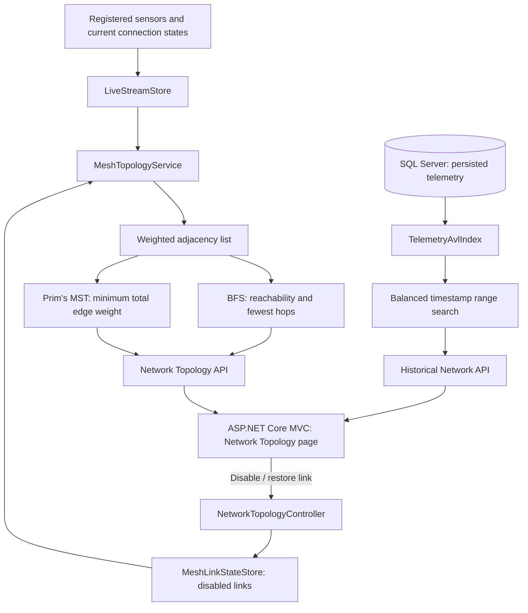

# 📡 Smart-X IoT Gateway 

**Network Topology, Breadth-First Search (BFS), Prim's Minimum Spanning Tree (MST), and AVL-based historical data queries.**

Smart-X is a .NET 10 IoT monitoring application built with **ASP.NET Core Web API**, **ASP.NET Core MVC**, and **SQL Server / Entity Framework Core**. Part 3 introduces **graph and tree data structures** to improve network routing and historical telemetry searches. It includes detailed explanations of the implementations, relevant code examples, and instructions for **compiling, running, and using the complete Smart-X application**. 

> **Scope:** The mesh network and energy costs are simulated. The system uses estimated energy values to demonstrate how Prim's algorithm selects efficient connections between sensors and the central gateway.

## 📑 Contents

- [Part 3 overview](#-part-3-overview)
- [Architecture and data flow](#️-architecture-and-data-flow)
- [Project structure](#-project-structure)
- [Compile and run the application](#-compile-and-run-the-application)
- [Using the Part 3 features](#️-using-the-part-3-features)
- [Part 3 data structures](#-part-3-data-structures)
- [Graphs, BFS, and Prim's MST](#-graphs-bfs-and-prims-mst)
- [AVL Tree and historical telemetry](#-avl-tree-and-historical-telemetry)
- [Performance and scalability](#-performance-and-scalability)
- [API reference](#-api-reference)
- [Part 3 demonstration guide](#-part-3-demonstration-guide)
- [Design decisions and limitations](#️-design-decisions-and-limitations)

---

## 🎯 Part 3 Overview

Part 3 adds two capabilities to Smart-X:

| Feature | Main classes | Contribution |
|---|---|---|
| **🌐 Weighted mesh network** | `MeshTopologyService`, `MeshLinkStateStore` | Models sensors and gateway links, finds reachable sensors with BFS, and selects a minimum-weight set of connections using Prim's algorithm |
| **🌲 Historical telemetry index** | `TelemetryAvlIndex`, `HistoricalNetworkController` | Balances timestamped readings in an AVL Tree, enabling efficient date-range searches and showing search diagnostics |

In the simulated network, **not every sensor connects directly to the central gateway**. Sensors may use neighbouring sensors as intermediate hops. When a connection fails, Smart-X rebuilds the active graph and recalculates the available BFS and MST routes.

An AVL Tree addresses a different problem: retrieving readings between two dates without scanning every entry in the in-memory history index.

---

## 🏗️ Architecture and Data Flow



---

### 🔄 Two Main Data Flows

The Smart-X application uses two main data flows to handle network routing and historical telemetry searches.

1. **🌐 Network Routing:** `LiveStreamStore` provides sensor identifiers and online status, `MeshTopologyService` creates weighted wireless connections and an adjacency list → **🔍 BFS** identifies reachable sensors and finds routes with the fewest hops, **🌳 Prim's algorithm** calculates the Minimum Spanning Tree (MST), **🖥️ MVC** displays the interactive network graph and routes.

2. **📊 Historical Telemetry Search:** SQL Server stores telemetry readings, `TelemetryAvlIndex` organises the readings by `(Timestamp, Id)` using an **🌲 AVL Tree**, date-range searches skip unnecessary branches to improve efficiency, **🖥️ MVC** displays the matching readings and tree performance details.

### 🏗️ Separation of Responsibilities

- **⚙️ Web API:** Handles the algorithms, network calculations and historical telemetry searches.
- **🖥️ MVC Application:** Displays the results and forwards user requests to the API.
- **🌐 JavaScript:** Draws the interactive network graph and updates the visual display.
- **💻 C# Services:** Implement BFS, Prim's algorithm and AVL Tree searching.

This separation keeps the application organised, makes the code easier to maintain and ensures that the main algorithms run in the **C# backend**.

---

## 📁 Project Structure

The Part 3 files of interest are:

```text
prog7312-2026-poe-ghanief/
├── SmartX_Api/
│   ├── Controllers/
│   │   ├── NetworkTopologyController.cs      # Graph and link-state endpoints
│   │   └── HistoricalNetworkController.cs    # AVL history endpoint
│   ├── Models/
│   │   └── MeshModels.cs                     # Graph nodes, links, routes, snapshot
│   ├── Services/
│   │   ├── MeshTopologyService.cs            # Adjacency list, BFS, Prim's MST
│   │   ├── MeshLinkStateStore.cs             # In-memory disabled link set
│   │   └── TelemetryAvlIndex.cs              # Balanced timestamp index
│   └── Program.cs                            # Dependency injection
├── SmartXMvc/
│   ├── Controllers/HomeController.cs         
│   ├── Services/SmartXApiClient.cs           
│   ├── Views/Home/NetworkTopology.cshtml     
│   └── wwwroot/
│       ├── js/network-topology.js            # SVG graph, history
│       └── css/network-topology.css          # Dashboard styling
├── SmartXMvc.slnx
└── docker-compose.yml
```

---

| File | How It Supports Part 3 |
|---|---|
| [`MeshTopologyService.cs`](SmartX_Api/Services/MeshTopologyService.cs) | Generates connections, filters active edges, builds adjacency lists, runs BFS and Prim's, and constructs routes |
| [`MeshLinkStateStore.cs`](SmartX_Api/Services/MeshLinkStateStore.cs) | Uses a `HashSet<string>` to remember manually disabled links |
| [`MeshModels.cs`](SmartX_Api/Models/MeshModels.cs) | Defines the network nodes, weighted edges and API responses |
| [`TelemetryAvlIndex.cs`](SmartX_Api/Services/TelemetryAvlIndex.cs) | Builds per-device AVL trees, balances nodes and answers timestamp-range queries |
| [`NetworkTopologyController.cs`](SmartX_Api/Controllers/NetworkTopologyController.cs) | Returns graph snapshots and applies simulated link changes |
| [`HistoricalNetworkController.cs`](SmartX_Api/Controllers/HistoricalNetworkController.cs) | Validates the sensor/date range and returns AVL query results |
| [`NetworkTopology.cshtml`](SmartXMvc/Views/Home/NetworkTopology.cshtml) | Provides graph, routing and historical telemetry controls |
| [`network-topology.js`](SmartXMvc/wwwroot/js/network-topology.js) | Draws graph edges/nodes and displays route/history results |

---

## 🚀 Compile and Run the Application

### ✅ Prerequisites

- **.NET 10 SDK** and Visual Studio with .NET 10 support (or a terminal and editor).
- **SQL Server LocalDB** for local development, or another accessible SQL Server instance.
- **Git** to clone the repository.
- **EF Core CLI**, if you prefer applying migrations manually.

Verify the SDK:

```powershell
dotnet --version
```

Install the EF Core CLI if necessary:

```powershell
dotnet tool install --global dotnet-ef
```

### 1. Clone the project

```powershell
git clone https://github.com/EMECPE/prog7312-2026-poe-ghanief.git
cd prog7312-2026-poe-ghanief
```

### 2. Restore and compile both projects

```powershell
dotnet restore SmartXMvc.slnx
dotnet build SmartXMvc.slnx
```

### 3. Configure SQL Server

Check `ConnectionStrings:DefaultConnection` in `SmartX_Api/appsettings.json`. For example:

```json
{
  "ConnectionStrings": {
    "DefaultConnection": "Server=(localdb)\\MSSQLLocalDB;Database=SmartXDb;Trusted_Connection=True;TrustServerCertificate=True;"
  }
}
```

The API applies its existing EF Core migrations and seed data during startup. To apply the existing migrations manually:

```powershell
dotnet ef database update --project SmartX_Api --startup-project SmartX_Api
```

### 4. Configure the MVC API address

Check `SmartXMvc/appsettings.json`:

```json
{
  "SmartXApi": {
    "BaseUrl": "http://localhost:5095"
  }
}
```

### 5. Start the API

In **Terminal 1**, run:

```powershell
dotnet run --project SmartX_Api --launch-profile http
```

Expected local API address: **http://localhost:5095**. Keep this terminal running.

### 6. Start the MVC dashboard

In **Terminal 2**, run:

```powershell
dotnet run --project SmartXMvc --launch-profile http
```

Open **http://localhost:5109** in a browser, then select **Network Topology**.

---

### 🔐 File-Encryption Key

**⚠️ IMPORTANT:** A valid file-encryption key is required for encrypted file operations to work correctly.

Configure `FileEncryption__Key` using a **Base64-encoded 32-byte key** through an environment variable or user secrets.

- 🔑 **Keep the same key** to decrypt previously uploaded files.
- 🔒 **Never commit your encryption key to GitHub.**
- ⚠️ **Losing or changing the key may prevent existing encrypted files from being decrypted.**

---

### 🐳 Optional: Run with Docker

The repository contains `docker-compose.yml` for `sqlserver`, `api`, and `mvc`. Add a local `.env` file at the repository root using **your own** values:

```dotenv
MSSQL_SA_PASSWORD=REPLACE_WITH_A_STRONG_LOCAL_PASSWORD
FILE_ENCRYPTION_KEY=REPLACE_WITH_A_BASE64_ENCODED_32_BYTE_KEY
```

Then run:

```powershell
docker compose up --build
```

Open **http://localhost:5109**. The Docker configuration routes MVC requests to the `api` container and API database requests to `sqlserver`. Never commit the `.env` file or real secrets.

**Troubleshooting:** If Network Topology cannot load, verify that the API is running and `SmartXApi:BaseUrl` matches its address. If historical queries fail, verify SQL Server connectivity and check the API console for migration or query errors. If a method or route name was recently renamed, ensure both the API and MVC projects have been rebuilt.

---

## 🖥️ Using Part 3 Features

| Part 3 feature | What you do | What the application shows |
|---|---|---|
| **🌐 Mesh Network Graph** | Open **Network Topology** | Sensors, gateway, weighted candidate connections and current connection states |
| **🔍 BFS traversal** | Select a sensor and inspect the BFS view | Reachability and a route using the fewest hops |
| **🌳 Prim's MST** | Recalculate the MST or select **Show MST links only** | Minimum-total-weight spanning tree, selected links and estimated total weight |
| **🔗 Link failure simulation** | Select a link, disable it, then restore it | Updated active edges, reachability and MST connections |
| **🌲 Historical telemetry** | Select a sensor, choose start/end dates and search | Chronological results plus AVL tree height, nodes visited and search time |

---

## 🧱 Part 3 Data Structures

| Structure / algorithm | Implementation | Why it improves Network Topology |
|---|---|---|
| **🌐 Graph — `Dictionary<string, List<Link>>`** | `MeshTopologyService.cs` | Stores each online vertex with its neighbours, avoiding a scan of every possible sensor pair during traversal |
| **🔍 BFS — `Queue<string>`** | `MeshTopologyService.cs` | Explores vertices level by level and finds routes with the fewest hops in an unweighted sense |
| **🧭 BFS parent map — `Dictionary<string, string?>`** | `MeshTopologyService.cs` | Records how each device was first reached so the route can be reconstructed |
| **🌳 Prim's MST — `PriorityQueue<Link, ...>`** | `MeshTopologyService.cs` | Always considers the lowest-weight candidate edge first while growing the tree |
| **✅ MST visited set — `HashSet<string>`** | `MeshTopologyService.cs` | Prevents adding a vertex twice and therefore avoids cycles in the selected tree |
| **🔗 Disabled link set — `HashSet<string>`** | `MeshLinkStateStore.cs` | Tracks unavailable links without duplicates and supports efficient membership checks |
| **🌲 AVL Tree — custom balanced BST** | `TelemetryAvlIndex.cs` | Maintains logarithmic tree height for timestamped historical readings |
| **📚 Per-device AVL index — `Dictionary<string, DeviceIndex>`** | `TelemetryAvlIndex.cs` | Selects the correct sensor's history without searching other sensors' trees |

---

## 🌐 Graphs, BFS, and Prim's MST

### 🔗 1. Representing the sensor mesh as a graph

- **📡 Vertices (`V`):** registered sensor devices and the `CENTRAL-GATEWAY`.
- **🔗 Edges (`E`):** candidate wireless connections between devices.
- **⚡ Weights:** simulated **transmit + receive energy** for one packet in **millijoules (`mJ`)**.
- **🟢 Active edges:** connections where both endpoints are online and the link has not been disabled.

The gateway connects directly to only a few sensors. Other sensors send data through nearby sensors to reach the gateway. These connections are generated using device identifiers to keep the simulation consistent.

#### 📊 Example with 15 sensors

| Connection type | Count | Reason |
|---|---:|---|
| Ring connections | 15 | Provide a path through adjacent simulated sensors |
| Alternate sensor connections | 15 | Provide additional routes if one link fails |
| Direct gateway uplinks | 4 | Give selected sensors direct gateway access |
| **Total candidate links** | **34** | Available before filtering offline devices and disabled links |

With **15 sensors + 1 gateway = 16 vertices**, a fully connected spanning tree contains exactly **15 edges (`V - 1`)**. Prim's algorithm selects those 15 tree edges from the available candidate links; it doesn't need all 34.

#### 💻 C# example: adjacency list

From [`MeshTopologyService.cs`](SmartX_Api/Services/MeshTopologyService.cs):

```csharp
private static Dictionary<string, List<Link>> MakeAdjacency(
    IEnumerable<string> onlineIds, List<Link> activeLinks)
{
    var graph = new Dictionary<string, List<Link>>(Ids);
    foreach (var id in onlineIds)
        graph[id] = new List<Link>();

    foreach (var link in activeLinks)
    {
        graph[link.From].Add(link);
        graph[link.To].Add(link with { From = link.To, To = link.From });
    }

    foreach (var neighbors in graph.Values)
        neighbors.Sort((a, b) => Ids.Compare(a.To, b.To));

    return graph;
}
```

**Why this structure?** An adjacency list stores **`O(V + E)`** graph information rather than allocating an `O(V²)` matrix. Each undirected connection is entered in both directions so it can be traversed either way.

---

### 🔍 2. Breadth-First Search (BFS)

**🎯 Purpose:** Starting from `CENTRAL-GATEWAY`, find the **reachable sensors** and reconstruct paths with the **fewest wireless hops**. BFS does **not** minimise the sum of energy weights; it minimises the number of edges on the route.

**⚙️ How It Works:**

1. **📥 Start:** Add the gateway to a queue and mark it as visited.
2. **🔎 Explore:** Take the first sensor from the queue and check its connections.
3. **🔗 Save Routes:** Add new sensors to the queue and remember which sensor they came from.
4. **🔄 Repeat:** Continue until the queue is empty. Sensors that cannot be reached from the gateway are marked as unreachable.

#### 💻 Example: BFS implementation

```csharp
private static (List<string> Order, Dictionary<string, string?> Parent)
    BreadthFirstSearch(Dictionary<string, List<Link>> graph, string start)
{
    var order = new List<string>();
    var parent = new Dictionary<string, string?>(Ids) { [start] = null };
    var queue = new Queue<string>();
    queue.Enqueue(start);

    while (queue.Count > 0)
    {
        string current = queue.Dequeue();
        order.Add(current);
        foreach (var edge in graph[current])
        {
            if (parent.ContainsKey(edge.To)) continue;
            parent[edge.To] = current;
            queue.Enqueue(edge.To);
        }
    }

    return (order, parent);
}
```

**Example:** If the route is **Gateway to Sensor A to Sensor B**, BFS reports **2 hops**. If a direct Gateway to Sensor B link exists, BFS prefers that **1-hop** route even when its energy estimate is higher. BFS visits each reachable vertex once and considers each active edge from its endpoints: **`O(V + E)`** time.

---

### 🌳 3. Prim's Minimum Spanning Tree (MST)

**🎯 Purpose:** Select a set of wireless links that connects all **gateway-reachable** vertices with the **lowest sum of edge weights**, without cycles. 

**⚙️ How It Works:**

1. **📡 Start:** Begin at the central gateway.
2. **📥 Add Connections:** Add the gateway's available connections to a `PriorityQueue`.
3. **⚡ Choose:** Select the connection with the lowest energy cost that leads to a new sensor.
4. **🔗 Connect:** Add that sensor to the tree and check its available connections.
5. **🔄 Repeat:** Continue until all sensors that can reach the gateway are connected.

#### 💻 Example: Prim's edge selection

```csharp
var visited = new HashSet<string>(Ids) { start };
var parent = new Dictionary<string, string?>(Ids) { [start] = null };
var selected = new List<Link>();
int total = 0;
var minHeap = new PriorityQueue<Link, (int Cost, string From, string To)>();

void EnqueueNeighbors(string id)
{
    foreach (var edge in graph[id])
        if (!visited.Contains(edge.To))
            minHeap.Enqueue(edge, (edge.Cost, edge.From, edge.To));
}

EnqueueNeighbors(start);
while (minHeap.TryDequeue(out var edge, out _))
{
    if (!visited.Add(edge.To)) continue;  // Avoid cycles.
    selected.Add(edge);
    total += edge.Cost;
    parent[edge.To] = edge.From;
    EnqueueNeighbors(edge.To);
}
```

**Important:** Prim's optimises the **total selected tree weight**. It does **not** guarantee that each individual sensor has the minimum-energy path to the gateway. The paths displayed for the MST follow the selected tree edges.

---

### ⚡ 4. How the simulated energy weights are calculated

To make the MST weights meaningful, each wireless connection is assigned an **estimated energy cost**, measured in millijoules (mJ). Prim's algorithm uses these values to select the connections with the lowest total cost.

#### 💻 Example: per-packet energy

```csharp
private static int EstimateEnergyMilliJoules(int distanceMetres, int attempts)
{
    const int receivePowerMw = 42;
    const int durationMs = 40;
    int transmitPowerMw = 55 + 2 * distanceMetres;

    return Math.Max(1, (int)Math.Ceiling(
        (transmitPowerMw + receivePowerMw)
        * durationMs * attempts / 1000d));
}
```

The general calculation is:

```text
Energy (mJ) = [TX power (mW) + RX power (mW)]
              × transmission duration (ms)
              × expected attempts / 1000
```

| Simulated distance | TX power | Attempts | Calculation | Displayed weight |
|---:|---:|---:|---|---:|
| 14 m | 83 mW | 1 | `(83 + 42) × 40 × 1 ÷ 1000 = 5.00` | **5 mJ** |
| 17 m | 89 mW | 1 | `(89 + 42) × 40 × 1 ÷ 1000 = 5.24` | **6 mJ** |
| 43 m | 141 mW | 2 | `(141 + 42) × 40 × 2 ÷ 1000 = 14.64` | **15 mJ** |


The calculated energy cost is **rounded up to the nearest whole number**. These values are simulated and remain consistent for each connection.

**Example interpretation:** If the currently selected MST contains edges with weights of 5 mJ, 6 mJ and 15 mJ, those values contribute **26 mJ** to the total MST weight. This is a **sum of selected link costs for one illustrative packet per edge**, not total application power consumption.

### 🔗 5. Simulated wireless-link failure and recovery

The topology recalculates when a user disables an existing candidate link:


1. The disabled connection is saved in `MeshLinkStateStore` using the two sensor IDs (e.g., `A|B`). A `HashSet<string>` ensures the same connection isn't stored twice.
2. `MeshTopologyService` excludes links with offline endpoints and links marked as disabled when building the **active adjacency list**.
3. **BFS** recalculates reachable devices and fewest-hop routes.
4. **Prim's** recalculates the MST from the surviving connections.
5. The MVC graph displays the disabled link and any changed selected routes. If no alternative exists, the device can be **online but unreachable**.

#### 💻 Example: disabled link state

```csharp
public void SetDisabled(string from, string to, bool disabled)
{
    lock (_gate)
    {
        string key = EdgeKey(from, to);
        if (disabled) _disabled.Add(key);
        else _disabled.Remove(key);
    }
}
```

**Why this matters:** If a connection fails, the sensor can still be online. The system can find another route without changing the sensor or its saved readings. Failed connections are stored temporarily in memory and reset when the API restarts.

---

## 🌲 AVL Tree and Historical Telemetry

### 🌱 1. Why an AVL Tree?

Smart-X must retrieve past readings for a chosen sensor between two timestamps. A regular Binary Search Tree can become a long chain when readings arrive in sorted timestamp order, leading to **`O(n)`** searching in the worst case.

An **AVL Tree** is a Binary Search Tree (BST) that automatically keeps itself balanced. When new data is added, it uses rotations to prevent one side from becoming too tall. This keeps the tree height at **`O(log n)`**, allowing efficient searches.

The index in [`TelemetryAvlIndex.cs`](SmartX_Api/Services/TelemetryAvlIndex.cs) uses:

- **📚 A separate tree per sensor**, found through `Dictionary<string, DeviceIndex>`.
- **🕒 A compound key `(Timestamp, Id)`**, retaining different readings that have the same timestamp.
- **🔄 Left/right and double rotations** to preserve AVL balance.
- **🔍 Range traversal with branch pruning** to skip timestamps outside the requested interval.
- **📊 Diagnostics** showing indexed count, tree height, nodes visited and in-memory search time.

### 🔄 2. How self-balancing works

After inserting a reading, the tree recomputes the node height and its balance factor:

```text
Balance factor = height(left subtree) − height(right subtree)
```

A balance factor greater than `1` indicates a left-heavy subtree; below `-1` indicates a right-heavy subtree. The code applies the appropriate rotation:

#### 💻 Example: AVL rebalancing

```csharp
Refresh(node);
int balance = Height(node.Left) - Height(node.Right);

if (balance > 1)
{
    if (Compare(value, node.Left!.Reading) > 0)
        node.Left = RotateLeft(node.Left);
    return RotateRight(node);
}

if (balance < -1)
{
    if (Compare(value, node.Right!.Reading) < 0)
        node.Right = RotateRight(node.Right);
    return RotateLeft(node);
}

return node;
```

The code handles left-left, left-right, right-right and right-left insertion cases through single or double rotations. Balanced height matters because the number of levels searched grows slowly even when telemetry history becomes large.

---

### 🔍 3. Timestamp-range searching

For example, a user may request readings from **10:00 to 10:30**. The AVL traversal returns matching readings in timestamp order while avoiding subtrees whose values cannot fall in that interval.

#### 💻 Example: pruned range traversal

```csharp
private static void SearchRange(Node? n, DateTime from, DateTime to,
    int max, List<TelemetryReading> output, ref int nodesVisited)
{
    if (n is null || output.Count >= max) return;
    nodesVisited++;

    if (n.Reading.Timestamp >= from)
        SearchRange(n.Left, from, to, max, output, ref nodesVisited);

    if (n.Reading.Timestamp >= from &&
        n.Reading.Timestamp <= to && output.Count < max)
        output.Add(n.Reading);

    if (n.Reading.Timestamp <= to)
        SearchRange(n.Right, from, to, max, output, ref nodesVisited);
}
```

If the current node is **before** the requested range, the left subtree cannot contain any newer timestamps, so it is skipped. If the current node is **after** the range, the right subtree is skipped. An in-order traversal keeps returned readings chronological.

---

## 🔌 API Reference

### 🌐 Network topology

| HTTP method | Endpoint | Purpose |
|---|---|---|
| `GET` | `/api/networktopology` | Return nodes, candidate/active links, BFS traversal and Prim's MST results |
| `GET` | `/api/networktopology/route/{deviceIdentifier}` | Return routing and reachability information for a selected sensor |
| `PUT` | `/api/networktopology/links/state` | Disable or restore a valid candidate wireless link |
| `POST` | `/api/networktopology/links/reset` | Restore all manually disabled links |
| `GET` | `/api/networktopology/history` | Search sensor telemetry by date range using the AVL index |

---

## 🧪 Part 3 Demonstration Guide

These are **manual verification steps and expected results**, not claims that an automated suite has already passed.

| Demo | Action | Expected evidence |
|---|---|---|
| **1. Graph model** | Open **Network Topology** | Sensor nodes, gateway, weighted candidate links and online/disabled indicators |
| **2. BFS** | Select a sensor and inspect BFS traversal and route | Reachability and a route with the fewest hops |
| **3. Prim's MST** | Recalculate or select **Show MST links only** | Selected MST edges connect all gateway-reachable vertices without cycles |
| **4. MST total weight** | Compare individual green edge weights with the MST energy card | Total equals the sum of selected link weights, measured in simulated mJ |
| **5. Link failure** | Disable a link that currently belongs to the MST | BFS and Prim's recalculate using the active links; the result may change |
| **6. Alternative connection** | Inspect the route after a failure | A replacement path is used where available; otherwise a sensor becomes unreachable |
| **7. Restore links** | Restore the selected connection or use **Reset all** | Candidate connection becomes active again and the graph recalculates |
| **8. AVL history** | Select a sensor and search a timestamp interval | Chronological readings plus tree-height and nodes-visited diagnostics |
| **9. Timestamp ties** | Search an interval containing two rows with the same timestamp (if present) | Both distinct readings remain identifiable by their IDs |
| **10. Scalability evidence** | Compare wide and narrow AVL searches on a larger history | Actual tree height, nodes visited, returned count and traversal time |

---

## ⚖️ Design Decisions and Limitations

| Choice | Why it was made / limitation |
|---|---|
| **Simulated mesh connections** | Makes the project repeatable without radio hardware; sensor distances and connection availability are not physically measured |
| **Sparse weighted graph** | Shows realistic *multi-hop behaviour* in a demonstration without allocating every possible edge |
| **Adjacency list rather than a matrix** | Reduces memory for a sparse graph and supports efficient BFS traversal |
| **BFS** | Provides reachability and fewest-hop routes, not minimum-energy routes |
| **Prim's MST** | Minimises the **sum of selected tree-edge weights**, not the energy of every individual telemetry packet |
| **Estimated TX + RX energy** | Makes weights interpretable, but results are model assumptions rather than actual energy measurements |
| **HashSet link-failure state** | Supports fast simulation without a new database table; reset occurs on API restart |
| **In-memory AVL index** | Speeds repeat historical searches but initially loads readings from SQL and consumes RAM as history grows |
| **AVL search diagnostics** | Show tree-search effort but exclude SQL loading, index construction and UI rendering |
| **SVG graph display limit** | Limits rendered devices for readability; it is separate from backend graph calculation |
| **Demo-only control endpoints** | Suitable for a local assessment; production use would require authentication and authorisation |

---

## 📺 Video demonstration

[link]

**Module:** PROG7312 POE

**Student:** Ghanief Batchelor  
**Student number:** ST10440143
