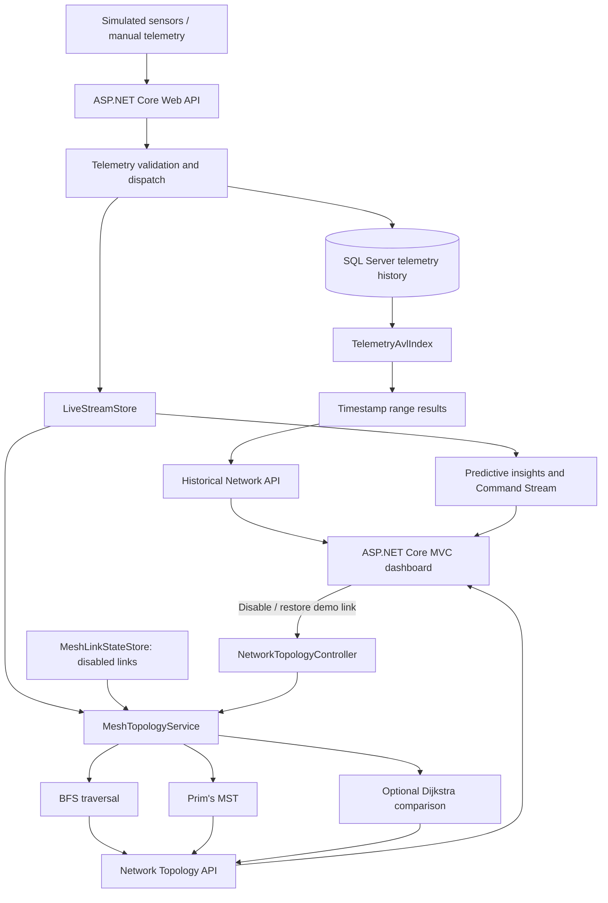

# 📡 Smart-X IoT Gateway

**A .NET 10 IoT monitoring platform with live telemetry, predictive actions, historical AVL indexing and an energy-weighted mesh network.**

Smart-X combines an **ASP.NET Core Web API**, **ASP.NET Core MVC dashboard** and **SQL Server / Entity Framework Core**. The application runs with simulated IoT readings.

> **Part 3 focus:** **Breadth-First Search (BFS)**; **Prim's Minimum Spanning Tree (MST)**; simulated wireless-link failure and recovery; and an **AVL Tree** for timestamp-range searches. The project uses **Prim's algorithm** to build a Minimum Spanning Tree (MST), connecting sensors while minimising the total estimated energy cost of the network connections.

## 📑 Contents

- [Project overview](#project-overview)
- [Architecture and data flow](#architecture-and-data-flow)
- [Project structure](#project-structure)
- [Getting started](#getting-started)
- [Using the application](#using-the-application)
- [Data structures and design choices](#data-structures-and-design-choices)
- [Part 3 - Graphs and mesh routing](#part-3--graphs-and-mesh-routing)
- [Part 3 - AVL historical telemetry](#part-3--avl-historical-telemetry)
- [Performance and scalability](#performance-and-scalability)
- [API reference](#api-reference)
- [Part 3 demonstration guide](#part-3-demonstration-guide)
- [Predictive action engine](#predictive-action-engine)
- [Existing functionality and regression checks](#existing-functionality-and-regression-checks)
- [Docker](#docker)
- [Design decisions and limitations](#design-decisions-and-limitations)
- [Video and author](#video-and-author)

---

## 🎯 Project Overview

The goal of Smart-X is to monitor a collection of IoT sensors and actuators from one dashboard. The system accepts numeric and Boolean telemetry, stores historical readings, identifies anomalies and supports simulated actuator commands. A background service generates telemetry every **5 seconds**.

**🚀 What the three parts contribute:**

| Area | Main functionality | Why it matters |
|---|---|---|
| **📡 Part 1 — Telemetry foundation** | Sensor registration, typed readings, storage, live dashboard, files | Creates the device and telemetry data used by the rest of the application |
| **⚙️ Part 2 — Data structures and actions** | FIFO/priority queues, dictionaries, hash sets, command stack/Undo, suggested actions | Handles incoming data, identifies critical readings and provides fast operational access |
| **🌐 Part 3 — Trees and graphs** | AVL history index, BFS, weighted mesh, Prim's MST, link-failure simulation | Adds efficient historical searches and demonstrates how sensors can communicate through energy-weighted routes |

For Part 3, a sensor can send readings to the gateway **through other sensors**, instead of needing a direct gateway connection. When a simulated wireless link fails, the graph is rebuilt using the links still available.

---

## 🏗️ Architecture and Data Flow



### 🔄 How Data Flows Through Smart-X

The system uses **two main data flows**, each handling a different task:

1. **🌐 Live Network Routing:** `LiveStreamStore` provides sensor identifiers and connection status → `MeshTopologyService` creates the network links and adjacency list → **BFS** checks network connectivity while **Prim's algorithm** calculates the Minimum Spanning Tree (MST) → the MVC Network Topology page displays the results as an interactive graph.

2. **🌳 Historical Telemetry Searching:** SQL Server stores telemetry readings → `TelemetryAvlIndex` organises the readings by timestamp using an AVL Tree → date-range searches focus on relevant branches instead of checking every reading → the MVC page displays the results along with tree performance details.

### 🏗️ Separation of Responsibilities

The **⚙️ Web API** handles the algorithms, data processing and calculations, while the **🖥️ MVC application** displays the results and sends user requests to the API.

This keeps the project organised, makes the code easier to maintain and avoids putting all the functionality into one controller or JavaScript file.

---

### Part 3 classes

| Class / file | Responsibility |
|---|---|
| [`MeshTopologyService.cs`](SmartX_Api/Services/MeshTopologyService.cs) | Builds the weighted mesh, adjacency list, BFS traversal, Prim's MST, optional Dijkstra routes and route costs |
| [`MeshLinkStateStore.cs`](SmartX_Api/Services/MeshLinkStateStore.cs) | Remembers which simulated wireless links have been disabled or restored |
| [`MeshModels.cs`](SmartX_Api/Models/MeshModels.cs) | Defines `MeshNode`, `MeshEdge`, `MeshRoute` and `MeshSnapshot` response models |
| [`TelemetryAvlIndex.cs`](SmartX_Api/Services/TelemetryAvlIndex.cs) | Builds a self-balancing timestamp index per sensor and handles historical range searches |
| [`NetworkTopologyController.cs`](SmartX_Api/Controllers/NetworkTopologyController.cs) | Returns the graph and accepts simulated link updates |
| [`HistoricalNetworkController.cs`](SmartX_Api/Controllers/HistoricalNetworkController.cs) | Validates date ranges and returns AVL history results |
| [`NetworkTopology.cshtml`](SmartXMvc/Views/Home/NetworkTopology.cshtml) | Network topology, routing controls, failure simulation, BFS and historical search UI |
| [`network-topology.js`](SmartXMvc/wwwroot/js/network-topology.js) | Draws interactive SVG nodes/edges and displays API results |

---

## 📁 Project Structure

```text
prog7312-2026-poe-ghanief/
├── SmartX_Api/
│   ├── Controllers/
│   │   ├── NetworkTopologyController.cs
│   │   ├── HistoricalNetworkController.cs
│   │   ├── CommandStreamController.cs
│   │   ├── SensorsController.cs
│   │   └── TelemetryController.cs
│   ├── Data/SmartXDbContext.cs
│   ├── Models/MeshModels.cs
│   ├── Services/
│   │   ├── MeshTopologyService.cs        # Graph, BFS, Prim's and route calculations
│   │   ├── MeshLinkStateStore.cs         # Failed/recovered simulated links
│   │   ├── TelemetryAvlIndex.cs          # Balanced tree and timestamp searches
│   │   ├── TelemetryDispatchService.cs   # FIFO and critical priority queues
│   │   ├── CommandOperationsService.cs   # Actuator commands and Undo
│   │   ├── LiveStreamStore.cs            # Device lookup and live trends
│   │   └── PredictiveInsightsService.cs  # Suggested Actions
│   └── Program.cs
├── SmartXMvc/
│   ├── Controllers/HomeController.cs
│   ├── Services/SmartXApiClient.cs
│   ├── Views/Home/NetworkTopology.cshtml
│   ├── wwwroot/js/network-topology.js
│   └── wwwroot/css/network-topology.css
├── SmartXMvc.slnx
└── docker-compose.yml

```

---

## 🚀 Getting Started

### Prerequisites

- **.NET 10 SDK** (`dotnet --version`)
- **SQL Server LocalDB** for local development, or an accessible SQL Server instance
- **Visual Studio with .NET 10 support** 
- **Git** to clone the repository
- **EF Core CLI tool** if applying migrations manually: `dotnet tool install --global dotnet-ef`

### 1. Clone the repository

```powershell
git clone https://github.com/EMECPE/prog7312-2026-poe-ghanief.git
cd prog7312-2026-poe-ghanief
```

Run the following commands from the **repository root** (the folder containing `SmartXMvc.slnx`).

### 2. Restore and build

```powershell
dotnet restore SmartXMvc.slnx
dotnet build SmartXMvc.slnx
```

### 3. Configure SQL Server

In `SmartX_Api/appsettings.json`, set `ConnectionStrings:DefaultConnection`. For example, the local configuration in the project uses:

```json
{
  "ConnectionStrings": {
    "DefaultConnection": "Server=(localdb)\\MSSQLLocalDB;Database=SmartXDb;Trusted_Connection=True;TrustServerCertificate=True;"
  }
}
```

The API attempts to apply existing EF Core migrations and seed demo data at startup. To apply migrations yourself, run:

```powershell
dotnet ef database update --project SmartX_Api --startup-project SmartX_Api
```

**Part 3 requires no new database tables or migrations.** Its simulated link failures are held in memory, while historical readings continue to come from the existing telemetry database.

### 4. Configure the MVC API address

In `SmartXMvc/appsettings.json`:

```json
{
  "SmartXApi": {
    "BaseUrl": "http://localhost:5095"
  }
}
```

### 5. Start the API and MVC application

**Terminal 1 — API:**

```powershell
dotnet run --project SmartX_Api --launch-profile http
```

Expected local address: **http://localhost:5095**.

**Terminal 2 — MVC dashboard:**

```powershell
dotnet run --project SmartXMvc --launch-profile http
```

Open **http://localhost:5109**. Visit **Network Topology** to view the Part 3 features.

**Troubleshooting:** If the graph shows a connection error, confirm the API is running on port `5095` and the MVC `SmartXApi:BaseUrl` matches it. If history queries fail, confirm SQL Server is running and the API can access its database. Check the API console for migration or seeding errors.


### 🔐 File Encryption Configuration

The `FileService.cs` uses encryption to keep uploaded files secure. To enable this, configure a **32-byte encryption key** encoded in Base64 using `FileEncryption__Key`. Store the key in a user secret or environment variable instead of your source code.

**Important:**
- 🔑 Keep the same key to decrypt previously uploaded files.
- 🔒 Store the key securely and never commit it to GitHub.
- 📁 Encrypted file uploads require a valid encryption key.

---

## 🖥️ Using the Application

| Page | What you can do |
|---|---|
| **📊 Dashboard** | View live telemetry readings, interactive charts and connected-device counts |
| **📡 Sensors** | Register, edit, delete, disconnect and reconnect sensor devices |
| **🌡️ Telemetry** | Submit sensor readings and view recorded telemetry data |
| **⚙️ Command Stream** | Monitor alerts and trends, send manual commands, Undo changes and view suggested actions |
| **🌐 Network Topology** | Explore the weighted mesh network, BFS traversal, Prim's Minimum Spanning Tree (MST), alternative routes and simulated link failures |
| **🌳 Historical Telemetry** | Search sensor readings by date range using the AVL Tree |
| **📁 Files** | Upload, download and delete sensor-related documents |

---

## 🧱 Data Structures and Algorithms

| Structure / Algorithm | File | Why it was chosen |
|---|---|---|
| **📥 FIFO Queue - `Queue<T>`** | `TelemetryDispatchService.cs` | Processes normal telemetry readings in the order they arrive |
| **🚨 Priority Queue - `PriorityQueue<T, int>`** | `TelemetryDispatchService.cs` | Handles critical anomalies before normal readings |
| **↩️ Stack - `Stack<T>`** | `CommandOperationsService.cs` | Supports Undo by reversing the most recent command first (LIFO) |
| **🔎 Dictionary - `Dictionary<TKey, TValue>`** | `LiveStreamStore.cs` | Provides fast sensor lookups using unique device identifiers |
| **📈 Sorted Dictionary - `SortedDictionary<TKey, TValue>`** | `LiveStreamStore.cs` | Keeps live telemetry trends ordered by timestamp |
| **🧩 HashSet - `HashSet<T>`** | `LiveStreamStore.cs` | Prevents duplicate alert and disconnected-device identifiers |
| **🌐 Graph - `Dictionary<string, List<Link>>`** | `MeshTopologyService.cs` | Represents sensors as nodes and wireless connections as weighted edges using an adjacency list |
| **🔍 BFS - `Queue<string>`** | `MeshTopologyService.cs` | Traverses the sensor network level by level to identify reachable devices and routes with the fewest hops |
| **🌳 Prim's Algorithm - `PriorityQueue<Link, ...>`** | `MeshTopologyService.cs` | Builds a Minimum Spanning Tree using the lowest available estimated energy costs |
| **✅ MST Visited Set - `HashSet<string>`** | `MeshTopologyService.cs` | Tracks visited sensors and prevents cycles while constructing the MST |
| **🔗 Link State Set - `HashSet<string>`** | `MeshLinkStateStore.cs` | Tracks disabled wireless connections without duplicates |
| **🌲 AVL Tree - Custom Implementation** | `TelemetryAvlIndex.cs` | Keeps historical telemetry balanced by timestamp for efficient date-range searches |

---


## 🌐 Part 3 — Graphs and Mesh Routing

### 🔗 1. Representing the Sensor Network as a Graph

Smart-X uses a **weighted graph** to represent how sensors communicate with each other and the central gateway. Each sensor is a node, while the wireless connections between them are represented as edges.

- **📡 Vertices (V):** Registered sensors and the `CENTRAL-GATEWAY`.
- **🔗 Edges (E):** Wireless connections between sensors and the gateway.
- **⚡ Edge Weights:** Estimated energy needed to send and receive a telemetry packet, measured in **millijoules (mJ)**.
- **🟢 Active Connections:** Links where both sensors are online and the connection has not been disabled.

#### 📊 Example: Network with 15 Sensors

A network containing **15 sensors** has **16 vertices**, including the central gateway.

The simulation normally generates **34 possible connections**:

| Connection Type | Number | Purpose |
|---|---:|---|
| 🔄 Ring connections | 15 | Connect neighbouring sensors |
| 🔗 Alternative connections | 15 | Provide additional paths through the network |
| 📡 Gateway connections | 4 | Connect selected sensors directly to the gateway |
| **Total** | **34** | **Available network connections** |

When all sensors are online and reachable, **Prim's algorithm selects 15 connections** to form a Minimum Spanning Tree (MST). The algorithm selects connections with the lowest total estimated energy cost while keeping the entire network connected.

### 💻 Code Example: Adjacency List

The project stores neighbours in a dictionary. This excerpt is from [`MeshTopologyService`](SmartX_Api/Services/MeshTopologyService.cs):

```csharp
private static Dictionary<string, List<Link>> MakeAdjacency(
    IEnumerable<string> onlineIds, List<Link> activeLinks)
{
    var graph = new Dictionary<string, List<Link>>(Ids);
    foreach (var id in onlineIds) graph[id] = new List<Link>();
    foreach (var link in activeLinks)
    {
        graph[link.From].Add(link);
        graph[link.To].Add(link with { From = link.To, To = link.From });
    }
    foreach (var neighbors in graph.Values)
        neighbors.Sort((a, b) => Ids.Compare(a.To, b.To));
    return graph;
}
```

Each connection is stored in **both directions**, because a link can be traversed from either endpoint. Sorting neighbours also makes BFS traversal order reproducible. 

---

### 🔍 2. Breadth-First Search (BFS)

**🎯 Purpose:** Starting from `CENTRAL-GATEWAY`, BFS explores the network to identify reachable sensors and find routes with the **fewest wireless hops**.

**⚙️ How It Works:**

1. **📥 Start at the Gateway:** Add `CENTRAL-GATEWAY` to a `Queue<string>` and mark it as visited.
2. **🔎 Explore Neighbours:** Remove the first node from the queue and check its neighbouring sensors.
3. **🔗 Track Routes:** Add unvisited neighbours to the queue and record their parent nodes to reconstruct the route.
4. **🔄 Continue Traversal:** Repeat until the queue is empty and all reachable sensors have been explored.

#### 💻 Code Example: BFS Implementation

From [`MeshTopologyService.BreadthFirstSearch`](SmartX_Api/Services/MeshTopologyService.cs):

```csharp
private static (List<string> Order, Dictionary<string, string?> Parent) BreadthFirstSearch(
    Dictionary<string, List<Link>> graph, string start)
{
    var order = new List<string>();
    var parent = new Dictionary<string, string?>(Ids) { [start] = null };
    var queue = new Queue<string>();
    queue.Enqueue(start);
    while (queue.Count > 0)
    {
        string current = queue.Dequeue();
        order.Add(current);
        foreach (var edge in graph[current])
        {
            if (parent.ContainsKey(edge.To)) continue;
            parent[edge.To] = current;
            queue.Enqueue(edge.To);
        }
    }
    return (order, parent);
}
```

**Performance:** BFS runs in time with an adjacency list. Each reachable vertex is discovered once, and each active undirected edge is considered from its endpoints. Its parent dictionary also identifies online devices that cannot be reached from the gateway.

---

### 🌳 3. Prim's Minimum Spanning Tree (MST)

**🎯 Purpose:** Prim's algorithm selects wireless connections that keep all gateway-reachable sensors connected while using the **lowest total estimated energy cost** and avoiding cycles.

**⚙️ How It Works:**

1. **📡 Start at the Gateway:** Begin building the Minimum Spanning Tree from `CENTRAL-GATEWAY`.
2. **📥 Add Available Connections:** Insert the gateway's available wireless links into a min-heap using `PriorityQueue`.
3. **⚡ Choose the Lowest-Cost Link:** Select the connection with the lowest estimated energy cost that leads to a sensor not already included in the MST.
4. **🔗 Expand the Network:** Add the selected sensor to the MST and insert its available outgoing connections into the priority queue.
5. **🔄 Repeat the Process:** Continue selecting the lowest-cost valid connections until all gateway-reachable sensors are connected.

**✅ Result:** A Minimum Spanning Tree that connects all reachable sensors using the lowest total edge weight without creating unnecessary loops.

#### Code example: selecting MST edges

From [`MeshTopologyService.PrimsMinimumSpanningTree`](SmartX_Api/Services/MeshTopologyService.cs):

```csharp
var visited = new HashSet<string>(Ids) { start };
var parent = new Dictionary<string, string?>(Ids) { [start] = null };
var selected = new List<Link>();
int total = 0;
var minHeap = new PriorityQueue<Link, (int Cost, string From, string To)>();

void EnqueueNeighbors(string id)
{
    foreach (var edge in graph[id])
        if (!visited.Contains(edge.To))
            minHeap.Enqueue(edge, (edge.Cost, edge.From, edge.To));
}

EnqueueNeighbors(start);
while (minHeap.TryDequeue(out var edge, out _))
{
    if (!visited.Add(edge.To)) continue; 
    selected.Add(edge);
    total += edge.Cost;
    parent[edge.To] = edge.From;
    EnqueueNeighbors(edge.To);
}
```

---

### 4. How the energy values (5 mJ, 6 mJ, 15 mJ) are calculated

Arbitrary costs would allow an MST calculation, but wouldn't explain *why* one wireless link is preferred. This project therefore assigns each link a repeatable **estimated energy cost**.

The C# method is [`EstimateEnergyMilliJoules`](SmartX_Api/Services/MeshTopologyService.cs):

```csharp
private static int EstimateEnergyMilliJoules(int distanceMetres, int attempts)
{
    const int receivePowerMw = 42;
    const int durationMs = 40;
    int transmitPowerMw = 55 + 2 * distanceMetres;
    return Math.Max(1, (int)Math.Ceiling(
        (transmitPowerMw + receivePowerMw) * durationMs * attempts / 1000d));
}
```

**Worked examples using the same formula:**

| Simulated distance | TX power | Attempts | Calculation | Displayed cost |
|---:|---:|---:|---|---:|
| 14 m | 83 mW | 1 | `(83 + 42) × 40 × 1 / 1000 = 5.00` | **5 mJ** |
| 17 m | 89 mW | 1 | `(89 + 42) × 40 × 1 / 1000 = 5.24` | **6 mJ** (rounded up) |
| 43 m | 141 mW | 2 | `(141 + 42) × 40 × 2 / 1000 = 14.64` | **15 mJ** (rounded up) |

**Important distinction:** Prim's minimises the **sum of the edges in the selected tree**. It does **not** necessarily minimise the energy used by the route to *each individual* sensor or the energy consumed by every packet in a full traffic workload. 

---

### 5. Simulated link failure and network recovery

The extra gateway uplinks and alternative sensor links let the application demonstrate how a mesh reacts when a connection goes down.

- `MeshLinkStateStore` keeps disabled edge keys in a `HashSet<string>`.
- `MeshTopologyService.Calculate()` removes failed and offline-endpoint links from the **active** adjacency list.
- BFS, Prim's MST and optional Dijkstra routes are recalculated from that active graph.
- A sensor remains reachable **only if another path exists**. Otherwise it is reported as unreachable even if the sensor itself is still online.
- Restoring a link, or pressing **Reset all**, makes it available for subsequent calculations.

The changes are temporary **in-memory simulation state**. They do not disconnect hardware, delete SQL data or modify sensor registrations.

---

## 🌳 Part 3 - AVL Historical Telemetry

### 1. Why use an AVL Tree?

A regular Binary Search Tree (BST) can become a long chain when readings arrive in timestamp order. Searching that badly shaped tree can approach **O(n)**. An AVL Tree checks the height difference between subtrees after insertion and rotates nodes to keep the height **O(log n)**.

This suits Smart-X because historical telemetry is naturally timestamped, and users frequently ask: **“Show readings from this date and time to that date and time.”**

The AVL implementation in [`TelemetryAvlIndex.cs`](SmartX_Api/Services/TelemetryAvlIndex.cs) uses:

- **One index per device**, stored in a `Dictionary<string, DeviceIndex>`.
- A comparison key of **`(Timestamp, Id)`**. The database ID breaks ties so two readings at the same timestamp are retained.
- **Left and right rotations**, plus double rotations where necessary.
- **In-order range traversal**, which returns matching readings chronologically.
- **Branch pruning**, so subtrees outside the requested time interval aren't searched unnecessarily.

### 2. How balancing works

After inserting a reading, the tree calculates the difference between left and right subtree heights. The excerpt below is taken from the project's `Insert` method:

```csharp
Refresh(node);
int balance = Height(node.Left) - Height(node.Right);
if (balance > 1)
{
    if (Compare(value, node.Left!.Reading) > 0)
        node.Left = RotateLeft(node.Left);
    return RotateRight(node);
}
if (balance < -1)
{
    if (Compare(value, node.Right!.Reading) < 0)
        node.Right = RotateRight(node.Right);
    return RotateLeft(node);
}
return node;
```

**Why this matters:** For 100,000 indexed readings, a balanced tree has a height measured in **tens of levels**, not a chain of 100,000 nodes. This controls lookup depth even when records arrive mostly in date order. This is a complexity statement, not a benchmark result.

### 3. How timestamp-range searches work

For a request such as **10:00–10:30**, the search follows only branches that might contain timestamps inside that interval. In-order traversal returns the results in chronological order.

From the source's `SearchRange` method:

```csharp
private static void SearchRange(Node? n, DateTime from, DateTime to,
    int max, List<TelemetryReading> output, ref int nodesVisited)
{
    if (n is null || output.Count >= max) return;
    nodesVisited++;
    if (n.Reading.Timestamp >= from)
        SearchRange(n.Left, from, to, max, output, ref nodesVisited);
    if (n.Reading.Timestamp >= from && n.Reading.Timestamp <= to && output.Count < max)
        output.Add(n.Reading);
    if (n.Reading.Timestamp <= to)
        SearchRange(n.Right, from, to, max, output, ref nodesVisited);
}
```

If the current timestamp is **before** the requested range, the left branch is skipped. If it is **after** the range, the right branch is skipped. This is the advantage over looping through every historical reading.

### 4. How it works with SQL Server

SQL Server remains the source of truth. The tree is an **in-memory query index**, not a replacement database.

1. On the first history query for a sensor, the index loads that sensor's existing readings from SQL Server.
2. Each reading is inserted into the AVL Tree; rotations maintain balance.
3. Subsequent queries fetch only newer rows with a higher database `Id` and add them to the tree.
4. Deleting readings or sensors invalidates the affected cached tree so the next query can rebuild it.
5. A `SemaphoreSlim` protects the shared in-memory index from concurrent updates and searches.

The API validates the device, checks the date interval, and limits responses to **1–500 rows** per query.

### 5. What the AVL diagnostics mean

The History panel shows:

| Field | Meaning |
|---|---|
| **Indexed readings** | Total readings currently represented in that sensor's AVL index |
| **Tree height** | Longest root-to-leaf path, in nodes; useful evidence of balancing |
| **Nodes visited** | Number of tree nodes examined during the current range query |
| **Returned readings** | Number of results shown (subject to the query limit) |
| **Search milliseconds** | Time spent **only traversing the in-memory AVL Tree** |

**Measurement boundary:** The displayed search time does **not** include SQL fetching, index construction, network travel or MVC rendering. A first-time request may be much slower because it loads and indexes historical rows; that setup cost must not be confused with the timed AVL lookup.

---

## 📊 Performance and Scalability

The following explains **how the algorithms scale as data grows**. These are mathematical bounds derived from the implementations, **not claimed real-world benchmark measurements**.

### Complexity summary

Let `V` be graph vertices (sensors plus gateway), `E` the number of active undirected links, `n` the readings indexed for one sensor, and `k` the readings returned by a range query.

| Operation | Time complexity | Space complexity | Why |
|---|---|---|---|
| Build adjacency list | `O(V + E)` before neighbour sorting | `O(V + E)` | Creates an entry per vertex and two directed neighbour entries per undirected link |
| BFS traversal | **`O(V + E)`** | `O(V)` working space | Each reachable vertex is enqueued once |
| Prim's MST (priority queue) | **`O(E log E)`** | `O(V + E)` | Candidate edges are managed by a min-heap; visited set prevents cycles |
| Optional Dijkstra routes | **`O(E log E)`** upper bound | `O(V + E)` | Uses a heap to expand lower-cost paths |
| AVL insertion | **`O(log n)`** | `O(log n)` recursion stack | Rotations keep height logarithmic |
| AVL timestamp-range search | **`O(log n + k)`** on the built balanced index | `O(log n + k)` including results | Finds the range and visits matching entries while pruning others |
| Build a fresh AVL index | **`O(n log n)`** for insertion work | `O(n)` | Existing rows must be loaded and inserted once |
| Dictionary device lookup | **`O(1)` average** | `O(V)` | Hash lookup by device ID |

**Implementation detail:** The actual graph builder also sorts neighbour lists for deterministic output. That adds sorting work (up to approximately `O(E log E)` across all lists); the BFS complexity above refers to traversal **after** the graph is built.

### Scaling example 1 — More sensors

With **all devices online** and no failed links, the current sparse topology generates approximately `2n + g` candidate links for `n ≥ 5` sensors, where `g` is up to 4 gateway connections. It is **not** a complete graph with one link for every possible pair.

| Number of sensors | Vertices (including gateway) | Candidate links in this model | Links in a connected MST |
|---:|---:|---:|---:|
| 15 | 16 | 34 | 15 |
| 150 | 151 | 304 | 150 |
| 1,500 | 1,501 | 3,004 | 1,500 |

These link counts follow the **current topology generation rules**; real wireless networks would have different physical constraints. The important result is that candidate links grow approximately **linearly** with the number of sensors. BFS therefore scales with the graph rather than checking all sensor pairs.

### Scaling example 2 — More historical readings

A linear scan may examine up to **all n readings**, while an AVL index keeps the search depth logarithmic and visits matching results plus the nodes needed to reach them.

| Reading count for one sensor | Linear scan: worst-case records examined | Approximate `log2(n)` decision levels* |
|---:|---:|---:|
| 1,000 | 1,000 | 10 |
| 10,000 | 10,000 | 14 |
| 100,000 | 100,000 | 17 |

*The `log2(n)` column illustrates the **growth rate**; it is not a measured AVL height or nodes-visited count. Real AVL balancing and range size affect the exact values.*

For example, a date range returning **20 records** has an idealised search cost proportional to **`log n + 20`**, rather than scanning every record. On the other hand, a date range returning almost **all records** still takes **O(n)** to output those records — an AVL Tree cannot avoid reading the results the user asks to see.

### How to collect real performance evidence

To demonstrate performance without inventing timing figures:

1. Ensure one sensor has a substantial amount of persisted telemetry. Allow the 5-second simulation to generate history, or use an existing dataset.
2. Search a **wide** interval on the Network Topology page. Write down `indexedReadings`, `treeHeight`, `nodesVisited`, `returnedCount` and `searchMilliseconds`.
3. Search a **narrower** interval on the **same sensor**, with the same cache already populated.
4. Compare nodes visited and the returned result count. Repeat searches to account for timing variation.
5. If presenting results, state the dataset size, machine and time range. **Do not compare cold-start SQL loading to warmed AVL traversal as though they measure the same operation.**

| Query / dataset | Indexed readings | AVL height | Nodes visited | Rows returned | In-memory time (ms) |
|---|---:|---:|---:|---:|---:|
| Wide range — record during demo | — | — | — | — | — |
| Narrow range — record during demo | — | — | — | — | — |
| Larger dataset — record during demo | — | — | — | — | — |

The cells are intentionally left blank until actual test results are collected.

---

## 🔌 API Reference

### Network topology

| Method | Endpoint | Purpose |
|---|---|---|
| `GET` | `/api/networktopology` | Returns nodes, active/disabled links, BFS order, MST links, costs and sensor routes |
| `GET` | `/api/networktopology/route/{deviceIdentifier}` | Returns one sensor's reachability and current paths |
| `PUT` | `/api/networktopology/links/state` | Disables or restores a valid candidate wireless link |
| `POST` | `/api/networktopology/links/reset` | Restores all links disabled in the simulator |
| `GET` | `/api/networktopology/history` | Queries the AVL Tree for a sensor and timestamp range |

**Example: inspect the current network**

```powershell
curl.exe http://localhost:5095/api/networktopology
```

**Example: query historical readings** (replace the ID and dates with data that exists in your database)

```text
GET /api/networktopology/history?deviceIdentifier=SENSOR-TEMP-001&from=2026-11-01T00:00:00Z&to=2026-11-11T00:00:00Z&limit=200
```

The endpoint can return up to **500 records** per request. It also reports AVL index size, tree height, nodes visited and in-memory search time.

**Example: disable a synthetic wireless link**

```http
PUT /api/networktopology/links/state
Content-Type: application/json

{
  "from": "SENSOR-A",
  "to": "SENSOR-B",
  "disabled": true
}
```

The two endpoint IDs must form an **existing candidate link**. Use actual `from` and `to` values from the topology response, not the placeholder IDs above. Set `disabled` to `false` to restore a link. Reset all links with `POST /api/networktopology/links/reset`.

### MVC routes

The frontend calls its own MVC actions, which forward requests to the API:

- `GET /Home/NetworkTopologyData`
- `GET /Home/NetworkHistory`
- `POST /Home/UpdateMeshLink`
- `POST /Home/ResetMeshLinks`

The MVC link-update actions validate anti-forgery tokens. The underlying API's simulation endpoints **do not implement authentication or authorisation**, so the project should be demonstrated in a controlled local environment rather than exposed publicly without additional protection.

---

## 🧪 Part 3 Demonstration Guide

These are **manual verification steps and expected behaviours**, not claims that an automated test suite has passed. Run them while the API, MVC client and database are available.

| Demo | Steps | Expected result / explanation |
|---|---|---|
| **1. Weighted graph** | Open **Network Topology**; point out nodes, weighted connections and the gateway | Sensors are graph vertices; edges have estimated mJ costs; not every sensor connects directly to the gateway |
| **2. BFS** | Select a sensor and inspect **BFS Traversal** and **BFS fewest hops** | Sensors are visited in breadth-first order; the path minimises hop count, not energy |
| **3. Prim's MST** | Click **Recalculate MST** and **Show MST links only** | The green tree connects gateway-reachable nodes without cycles; for connected `V`, it has `V − 1` links |
| **4. MST energy** | Compare individual link labels with **Total MST energy** | Total MST energy is the sum of selected tree-link weights; it is not an electricity meter reading |
| **5. Link failure** | Select a currently active MST link and press **Disable link** | The link becomes disabled, and BFS/MST recompute from available edges; an alternate path is used if one exists |
| **6. Restore** | Press **Restore link** or **Reset all** | Connections become available again and routing is recalculated |
| **7. Unreachable sensor** | If possible, disable enough links to isolate a sensor or section | An online device without an active path to the gateway is reported as unreachable; don't confuse this with an offline device |
| **8. AVL history** | Select a sensor, enter **From** and **To** and click **Search History** | Results are chronological and show AVL height, nodes visited and in-memory lookup time |
| **9. Duplicate timestamps** | Query a period containing readings that share a timestamp, where present | Different reading IDs remain distinguishable; matching rows are retained |
| **10. Large-history evidence** | Compare wide and narrow searches on a sensor with many rows | Use actual indexed count / visited-node measurements to discuss pruning and logarithmic tree height |
| **11. Regression** | Revisit **Telemetry**, **Command Stream** and **Sensors** | Existing queue processing, alerts, Undo and registration features still function |

**Recommended presentation order:** Begin with the graph model → show BFS → show Prim's tree and total estimated weight → disable one wireless link → show an alternative route → finish with an AVL date-range query and its diagnostics. This demonstrates each rubric requirement without getting distracted by extra features.

---

## 🐳 Docker

The repository includes `docker-compose.yml` with three services:

- **`sqlserver`** — SQL Server 2022 with a persistent data volume.
- **`api`** — the ASP.NET Core API, available locally on port `5095`.
- **`mvc`** — the MVC web application, available locally on port `5109`.

Install Docker Desktop with Docker Compose. Create a local `.env` file in the repository root containing your **own** development credentials:

```dotenv
MSSQL_SA_PASSWORD=REPLACE_WITH_A_STRONG_LOCAL_PASSWORD
FILE_ENCRYPTION_KEY=REPLACE_WITH_BASE64_ENCODED_32_BYTE_KEY
```

The encryption key should represent exactly **32 random bytes encoded in Base64**. The `.env` file is ignored by Git; don't add real passwords or keys to the README or repository.

Run from the repository root:

```powershell
docker compose up --build
```

Then open **http://localhost:5109**. The Docker setup uses the container service name `api` for MVC-to-API communication and `sqlserver` for the database. Link-failure simulation state still resets whenever the API container restarts.

---

## ⚖️ Design Decisions and Limitations

**Why this design was chosen:** The assignment focuses on showing the role of data structures and algorithms. Keeping BFS, Prim's and AVL logic in dedicated C# services makes their use easier to inspect than hiding the logic in controller actions or client-side scripts. The visual graph makes their results understandable during a live demonstration.

| Decision or limitation | Effect / trade-off |
|---|---|
| **Synthetic mesh topology** | Repeatable demonstrations without radios; links are not based on measured position, RSSI or signal strength |
| **Energy-weighted edges** | Meaningful weights for Prim's, but only a simplified per-packet TX/RX estimate; not a battery-consumption measurement |
| **Sparse ring + extra links** | Demonstrates multi-hop routing and alternative connectivity without generating a fully connected graph |
| **Gateway-rooted Prim's MST** | Minimises summed selected edge weights for the reachable component; not every individual packet route is necessarily minimum energy |
| **Optional Dijkstra** | Makes the distinction between lowest-total-cost tree and lowest-cost individual route visible, but is **not required for the rubric's Prim's/Kruskal's choice** |
| **In-memory link-failure store** | Fast demonstration with no new migrations; resets on API restart and is shared across API requests |
| **In-memory per-device AVL cache** | Fast repeated range queries; first query loads SQL rows, and storing many readings consumes RAM |
| **AVL diagnostics** | Shows tree structure and traversal effort, but `searchMilliseconds` excludes database loading and web request time |
| **Graph rendering limit** | The SVG limits how many devices are drawn for readability (55 in the supplied JavaScript); backend graph calculations use the device set available to the API |
| **Local demo API controls** | MVC posts use anti-forgery validation, but direct API link controls lack authorisation and should not be exposed as a production control plane |

**Possible production improvements** would include real radio-link metrics, authenticated network-management endpoints, persistent per-link state, bounded historical indexing and benchmark measurements from large datasets. These are not claimed as currently implemented.

---

## 📺 Part 3 demonstration

**Project demonstration:** https://youtu.be/__WHbjxK4X0

- **Student:** Ghanief Batchelor
- **Student number:** ST10440143
- **Module:** PROG7312 POE
